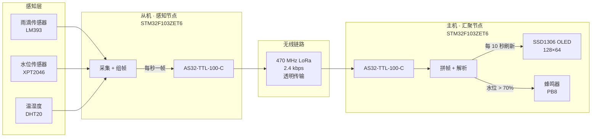
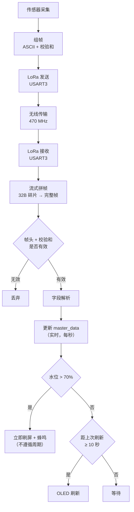
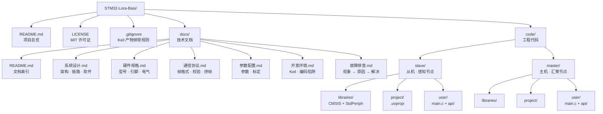

# STM32 LoRa 土壤墒情监测系统

> **STM32-Lora-Basi** — 基于 STM32F103ZET6 + AS32-TTL-100-C 的土壤墒情监测系统，通过 LoRa 无线组网完成数据采集与汇聚显示

<p align="left">
  
  
  
  
  
  
</p>

---

## 目录

- [系统概述](#系统概述)
- [硬件型号](#硬件型号)
- [系统架构](#系统架构)
- [功能特性](#功能特性)
- [目录结构](#目录结构)
- [快速开始](#快速开始)
- [引脚分配](#引脚分配)
- [通信协议](#通信协议)
- [可调参数](#可调参数)
- [技术文档](#技术文档)
- [实测数据](#实测数据)
- [已修复问题](#已修复问题)
- [当前限制](#当前限制)
- [开发环境](#开发环境)

---

## 系统概述

面向**土壤墒情监测**场景的 LoRa 无线组网系统。感知节点布设在野外测点，采集雨情、水位、温湿度三类环境参数，通过 470MHz LoRa 链路汇聚到接收节点集中显示与告警。

系统由两个角色组成：

| 角色 | 职责 | 硬件配置 |
|---|---|---|
| **从机（感知节点）** | 采集雨滴 + 水位 + DHT20 温湿度，组帧后每秒经 LoRa 上报 | STM32F103ZET6 + AS32-TTL-100-C + 三路传感器 |
| **主机（汇聚节点）** | 接收 LoRa 数据帧，拼帧解析，OLED 显示，水位超限告警 | STM32F103ZET6 + AS32-TTL-100-C + SSD1306 OLED |

两个节点之间**没有任何线缆连接**，完全靠 LoRa 无线通信。

---

## 硬件型号

### 主控

| 项 | 型号 / 规格 |
|---|---|
| MCU | **STM32F103ZET6** |
| 内核 | ARM Cortex-M3 |
| 封装 | LQFP144 |
| Flash | 512 KB（`IROM 0x08000000, 0x80000`） |
| RAM | 64 KB（`IRAM 0x20000000, 0x10000`） |
| 外部晶振 | 12 MHz |
| 系统时钟 | 72 MHz |

### 无线模块

| 项 | 型号 / 规格 |
|---|---|
| 型号 | **AS32-TTL-100-C** |
| 版本字符串 | `AS32-TTL-100-C-V9.0` |
| 频段 | 470 MHz（信道 0x3D = 471 MHz） |
| 调制 | LoRa（CSS 线性调频扩频） |
| 接口 | TTL 串口，9600 8N1 |
| 空中速率 | 2.4 kbps |
| 传输模式 | 透明传输 |
| 内部 FIFO | 256 字节 |

### 传感器（从机）

| 传感器 | 型号 / 规格 | 接口 | 供电 |
|---|---|---|---|
| 雨滴 | LM393 比较器雨滴模块 | DO(数字) + AO(模拟) | 3.3 V |
| 水位 | **XPT2046 液位转换板** | AO(模拟，0~1.0V) | **5 V** |
| 温湿度 | **DHT20** | 软件 I2C（地址 0x38） | 3.3 V |

### 显示（主机）

| 项 | 型号 / 规格 |
|---|---|
| 屏幕 | **SSD1306** 0.96 寸 OLED |
| 分辨率 | 128 × 64 |
| 接口 | 4 针 I2C（地址 0x3C） |
| 字库 | GB2312 一级汉字 3755 字 |

### 工具链

| 项 | 版本 |
|---|---|
| IDE | Keil MDK-ARM V5.24.2 |
| 编译器 | ARMCC V5.06 update 5 (build 528) |
| 器件包 | Keil.STM32F1xx_DFP 2.2.0 |

---

## 系统架构

### 系统拓扑



### 数据流



---

## 功能特性

### 从机（感知节点）

- **三路传感器采集**
  - 雨情：DO 数字量消抖 + AO 模拟量 10 次均值滤波 → 分 4 档
  - 水位：AO 模拟量 10 次均值滤波 → 非线性门限表换算 → 噪声死区处理
  - 温湿度：DHT20 软件 I2C 读取，失败自动重试
- **每秒上报**（`REPORT_INTERVAL_MS = 1000`）
- **ASCII 文本帧**，带累加和校验，对端串口助手可直接阅读
- **本地串口同步打印**中文数据，便于现场调试

### 主机（汇聚节点）

- **流式拼帧** — 解决 LoRa 模块按 32 字节分块吐数据的问题
- **帧校验** — 帧头 + 累加和双重验证，坏帧直接丢弃
- **OLED 显示** — 4 行中文，每 10 秒刷新（数据实时，显示节流）
- **水位告警** — 超过 70% 立即蜂鸣 + 显示"水位过高"，不遵循刷新周期
- **断线保护** — 5 秒无数据自动清告警、关蜂鸣器、显示"等待从机"

---

## 目录结构



---

## 快速开始

### 1. 硬件准备

| 项 | 从机 | 主机 |
|---|---|---|
| 主控板 | STM32F103ZET6 | STM32F103ZET6 |
| 无线模块 | AS32-TTL-100-C × 1 | AS32-TTL-100-C × 1 |
| 传感器 | 雨滴 + XPT2046 水位 + DHT20 | — |
| 显示 | — | SSD1306 0.96" OLED |
| 蜂鸣器 | 板载（PB8） | 板载（PB8） |

> **两块 LoRa 模块的地址、信道、空中速率、串口波特率必须完全一致**，否则收不到。
> 本工程统一配置：地址 `0x0000` / 信道 `0x3D`(471MHz) / 9600 8N1 / 2.4k / 透明传输。

### 2. 编译

Keil MDK 打开对应工程，按 **F7**：

```
code/slave/project/STM32F103ZET6_Project.uvprojx     ← 从机
code/master/project/STM32F103ZET6_Project.uvprojx    ← 主机
```

命令行编译：

```powershell
# 从机
& 'C:\Keil_v5\UV4\UV4.exe' -b 'code\slave\project\STM32F103ZET6_Project.uvprojx' -j0 -o build_slave.log

# 主机
& 'C:\Keil_v5\UV4\UV4.exe' -b 'code\master\project\STM32F103ZET6_Project.uvprojx' -j0 -o build_master.log
```

**编译状态**（已实测）：

| 工程 | 结果 | Code | RO-data | RW-data | ZI-data | HEX |
|---|---|---|---|---|---|---|
| 从机 | **0 Error / 3 Warning** | 12078 | 498 | 56 | 2664 | 35585 B |
| 主机 | **0 Error / 3 Warning** | 10610 | **122206** | 28 | 4492 | 373712 B |

> 3 个 Warning 均来自 `i2c.c` 的 `0x0F << 28` 整数溢出，是标准库示例代码遗留，不影响功能。
> 主机 122KB `RO-data` 是 GB2312 汉字字库（3755 字），用于 OLED 显示中文。

### 3. 烧录

两块板子分别烧录对应 HEX：

```
code/slave/project/Objects/STM32F103ZET6_Project.hex     ← 烧到从机板
code/master/project/Objects/STM32F103ZET6_Project.hex    ← 烧到主机板
```

### 4. 验证

**从机串口**（9600 8N1，**编码 GBK**）每秒输出：

```
温度:26.4℃,湿度:49.6%,无雨,水位:80%(ADC=716)
温度:26.5℃,湿度:52.2%,无雨,水位:80%(ADC=689)
```

**主机 OLED** 每 10 秒刷新：

```
温度:26.5
湿度:52.2
水位:80%
无雨
```

水位超过 70% 时**立即**变为：

```
温度:26.5
湿度:52.2
水位:75%!
水位过高
```

同时蜂鸣器每 500ms 翻转，发出"哔—哔—"告警声。

---

## 引脚分配

### 从机

| 功能 | 引脚 | 外设 / 模式 | 备注 |
|---|---|---|---|
| 雨滴 DO | **PC1** | 上拉输入 | 1=无水，0=有水 |
| 雨滴 AO | **PC2** | 模拟输入 | ADC1_IN12 |
| 水位 AO | **PA1** | 模拟输入 | ADC1_IN1，**必须拔 P10 跳线帽** |
| DHT20 SCL | **PB6** | 开漏输出 | 软件 I2C，需 4.7K~10K 上拉 |
| DHT20 SDA | **PB7** | 开漏/浮空 | 软件 I2C，需 4.7K~10K 上拉 |
| LoRa TXD→ | PB11 | USART3_RX | 模块 TXD 接 MCU RX |
| LoRa RXD← | PB10 | USART3_TX | 模块 RXD 接 MCU TX |
| LoRa MD0 | PB12 | 开漏输出 | 模式选择低位 |
| LoRa MD1 | PB13 | 开漏输出 | 模式选择高位 |
| LoRa AUX | PB14 | 浮空输入 | 模块忙/闲状态 |
| 调试串口 | PA9/PA10 | USART1 | 9600 8N1 |
| LED0 / LED1 | PB5 / PE5 | 推挽输出 | 低电平点亮 |

### 主机

| 功能 | 引脚 | 外设 / 模式 | 备注 |
|---|---|---|---|
| OLED SCL | **PB6** | 开漏输出 | 软件 I2C，需 4.7K~10K 上拉 |
| OLED SDA | **PB7** | 开漏/浮空 | 软件 I2C，需 4.7K~10K 上拉 |
| LoRa TXD→ | PB11 | USART3_RX | 模块 TXD 接 MCU RX |
| LoRa RXD← | PB10 | USART3_TX | 模块 RXD 接 MCU TX |
| LoRa MD0/MD1/AUX | PB12/PB13/PB14 | — | |
| 蜂鸣器 | **PB8** | 推挽输出 | 水位超限告警 |
| 调试串口 | PA9/PA10 | USART1 | 9600 8N1 |
| LED0 / LED1 | PB5 / PE5 | 推挽输出 | |

> **PB6/PB7 在两台板子上接不同外设**：从机接 DHT20，主机接 OLED。两台板子物理独立，不冲突。

详细电气参数与接线见 [docs/硬件规格.md](docs/硬件规格.md)。

---

## 通信协议

从机每秒发出一帧 **ASCII 文本帧**：

```
$RAIN,DHT20,T=26.5,H=52.2,ADC=4092,V=3297,WET=0,DO=1,LEVEL=0,WL=80*8B\r\n
```

| 字段 | 含义 | 范围 |
|---|---|---|
| `T=` | 温度 ℃（DHT20 失败为 `--`） | -50.0 ~ 100.0 |
| `H=` | 湿度 %RH（失败为 `--`） | 0.0 ~ 100.0 |
| `ADC=` | 雨滴 AO 原始 ADC | 0 ~ 4095 |
| `V=` | 雨滴 AO 电压 mV | 0 ~ 3300 |
| `WET=` | 雨滴湿润百分比 | 0 ~ 100 |
| `DO=` | 雨滴数字量（1=无水，0=有水） | 0 / 1 |
| `LEVEL=` | 雨情等级（0=无雨 1=小雨 2=中雨 3=大雨） | 0 ~ 3 |
| `WL=` | **水位百分比** | 0 ~ 100 |
| `*XX` | 校验和：`*` 之前所有字节累加取低 8 位，两位大写 HEX | — |

帧长 71~79 字节。完整协议见 [docs/通信协议.md](docs/通信协议.md)。

---

## 可调参数

### 从机

| 参数 | 位置 | 当前值 |
|---|---|---|
| 上报周期 | `sensor_report.h` → `REPORT_INTERVAL_MS` | **1000** ms |
| 雨情阈值 | `common.h` → `RAIN_ADC_THRESHOLD_*` | 2500 / 2000 / 1500 |
| 雨滴滤波次数 | `common.h` → `RAIN_FILTER_TIMES` | 10 |
| 水位噪声死区 | `level.h` → `LEVEL_IGNORE_BELOW_MM` | **9** mm |
| 水位量程 | `level.h` → `LEVEL_RANGE_MM` | 90 mm |
| 水位采样次数 | `level.h` → `LEVEL_SAMPLE_TIMES` | 10 |
| LoRa 信道 | `lora_as32.h` → `LORA_DEFAULT_CHAN` | 0x3D |

### 主机

| 参数 | 位置 | 当前值 |
|---|---|---|
| **水位告警阈值** | `master_app.h` → `WATER_ALARM_THRESHOLD` | **70** % |
| **屏幕刷新周期** | `master_app.h` → `OLED_REFRESH_MS` | **10000** ms |
| 断线超时 | `main.c` → `RX_TIMEOUT_MS` | 5000 ms |
| 拼帧缓冲 | `frame_assembler.h` → `FRAME_ASM_BUF_SIZE` | 256 B |
| 字库开关 | `oled_font.h` → `OLED_USE_FONT` | **1**（必须） |

完整参数与标定方法见 [docs/参数配置.md](docs/参数配置.md)。

---

## 技术文档

| 文档 | 内容 |
|---|---|
| [docs/README.md](docs/README.md) | 文档索引与阅读导航 |
| [系统设计](docs/系统设计.md) | 系统架构、LoRa 链路、软件分层、设计取舍 |
| [硬件规格](docs/硬件规格.md) | 实际型号、引脚定义、电气参数、接线清单 |
| [通信协议](docs/通信协议.md) | 帧格式、字段语义、校验算法、拼帧机制 |
| [参数配置](docs/参数配置.md) | 全部可调参数、调优方法、水位标定 |
| [开发环境](docs/开发环境.md) | Keil 配置、编译烧录、编码陷阱 |
| [故障排查](docs/故障排查.md) | 现象 → 原因 → 解决（含实测日志） |

---

## 实测数据

### 传感器实测

| 参数 | 实测值 | 条件 |
|---|---|---|
| 雨滴 ADC | 2895 ~ 3500 | 干燥 |
| 雨滴 ADC | 明显下降 | 滴水后 |
| 水位 ADC | ≈ 20 | 空水 |
| 水位 ADC | ≈ 716 | 满水（显示 80%） |
| 温度 | 26.4 ~ 26.5 ℃ | 室温 |
| 湿度 | 49.6 ~ 52.2 %RH | 室内 |

### 时序实测

| 项 | 实测 |
|---|---|
| 从机上报间隔 | ≈ 1 秒 |
| 主机 OLED 刷新 | 10 秒 |
| 告警响应延迟 | < 1 秒（下一帧到达即触发） |
| 单次上报耗时 | ≈ 200 ~ 250 ms |

---

## 已修复问题

以下问题都是实际调试中踩到并修复的，**改动时勿回退**：

| 问题 | 现象 | 根因 | 修复 |
|---|---|---|---|
| **LoRa 帧被拆碎片** | 主机屏幕一直 `温度:--` | AS32 模块按 32 字节分块吐数据，每次 IDLE 当一帧解析必然失败 | 新增 `frame_assembler.c` 流式拼帧 |
| **拼帧器垃圾堵塞** | 偶发卡死拼不出帧 | 缓冲残留垃圾等不到换行，堵死后续正常帧 | 缓冲内无 `$` 即清空重同步 |
| **水位没水也报 9mm** | 干燥时显示 9mm | 噪声落进 10% 档，10%×90mm=9mm | 加 `LEVEL_IGNORE_BELOW_MM` 死区 |
| **告警要等 20 秒** | 水位超限后迟迟不显示 | 只标脏不立即刷屏 | 改边沿触发，跳变立即刷屏 |
| **断线蜂鸣器长响** | 断线后一直响 | `waterAlarm` 保持旧值 | 超时分支清告警 + 关蜂鸣器 |
| **串口 3 次调用白等 150ms** | 主循环卡顿 | 单一 DMA 缓冲，连续调用互相等待 | 拼成一个缓冲一次发出 |
| **`s_txLine` 超 DMA 上限** | 日志被静默截断 | 272 > 256 | 缩到 240 + 双重上限检查 |
| **OLED 汉字不显示** | 显示方块/乱码 | `OLED_USE_FONT = 0` 字库未编译 | 改为 1 |
| **`oled.h` 引用不存在的头** | 编译报错 | 移植残留 `#include "usart.h"` | 删除 |
| **缺 `OLED_ADDR` 等宏** | 编译报错 | 宏原本在丢失的 `usart.h` 里 | 补进 `i2c.h` |
| **ADC 外设复位** | 转换永不完成 | 采样函数里做了 `RCC_APB2PeriphResetCmd(ADC1)` | 删除复位，只初始化一次 |
| **ISR memset 吞帧** | 偶发丢整帧 | 中断开头 memset 清掉整帧 | 改为消费者清空 |
| **DHT20 校准误判** | 校准被永久跳过 | `0xFF & 0x18 == 0x18` 优先级问题 | 加括号 |
| **ADC 死等** | 程序卡死 | `while(EOC==RESET);` 无超时 | 加超时计数 |
| **消抖逻辑失效** | 3 次实际只比 1 次 | 一抖动就提前退出 | 走满次数 |

---

## 当前限制

| 限制 | 说明 |
|---|---|
| **点对点组网** | 当前为 1 主 1 从；扩展多从机需改协议加地址字段 |
| **单向数据流** | 从机→主机单向；主机可发但固件未用于控制从机 |
| **无应答重传** | 透明传输，丢帧不重传，靠 1 秒周期冗余 |
| **无时间戳** | 帧内不含时间，主机不判断数据新鲜度（靠 5 秒超时兜底） |
| **水位量程 90mm** | 门限表按 90mm 标定，换传感器需重新标定 |
| **常供电设计** | 无低功耗休眠，适合市电或大容量电池场景 |
| **水位实测满水 80%** | 门限表按旧量程标定，需按实测 ADC 重新标定才能到 100% |

---

## 开发环境

| 项 | 版本 / 说明 |
|---|---|
| IDE | Keil MDK-ARM **V5.24.2** |
| 编译器 | ARMCC **V5.06 update 5** (build 528) |
| 器件包 | Keil.STM32F1xx_DFP **2.2.0** |
| 目标芯片 | STM32F103ZE（512KB Flash / 64KB RAM） |

> **重要**：所有 `.c` / `.h` 的编码**不统一** —— 多数是 GBK，`level.c`/`level.h` 是 UTF-8 与 GBK 混合。
> 修改时只改纯 ASCII 的代码区，中文注释一个字节都别碰，否则整份文件会毁掉。
> 详见 [docs/开发环境.md](docs/开发环境.md)。

---

## 许可证

[MIT](LICENSE)

---

## 参考资料

- STM32F103x8/B/C/D/E 参考手册 **RM0008**（ST 官方）
- STM32F103ZET6 数据手册
- AS32-TTL-100-C 模块使用手册（成都泽耀科技）
- XPT2046 液位转换板说明
- DHT20 温湿度传感器数据手册
- SSD1306 OLED 驱动 IC 手册
