# 这个代码到底在干什么？—— 零基础代码导读

> 一个文件讲清 **STM32 LoRa 土壤墒情监测系统** 的全部代码逻辑。
> 不需要任何单片机基础，跟着读完就能明白每一行在做什么。

---

## 目录

- [第 0 章 先搞懂这个项目在干什么](#第-0-章-先搞懂这个项目在干什么)
- [第 1 章 两块板子怎么配合](#第-1-章-两块板子怎么配合)
- [第 2 章 代码文件怎么分工](#第-2-章-代码文件怎么分工)
- [第 3 章 从机代码逐段拆解](#第-3-章-从机代码逐段拆解)
- [第 4 章 主机代码逐段拆解](#第-4-章-主机代码逐段拆解)
- [第 5 章 两个必须懂的硬核概念](#第-5-章-两个必须懂的硬核概念)
- [第 6 章 读代码的正确顺序](#第-6-章-读代码的正确顺序)
- [第 7 章 常见疑问解答](#第-7-章-常见疑问解答)
- [第 8 章 名词速查表](#第-8-章-名词速查表)

---

## 第 0 章 先搞懂这个项目在干什么

### 一句话概括

**两块单片机，一块在外面量数据，一块在屋里看数据，中间靠无线电连起来。**

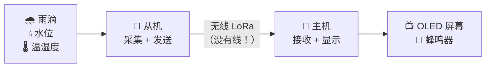

### 用生活比喻

| 角色 | 比喻 |
|---|---|
| **从机** | 像**田野里的哨兵**，每秒钟量一次雨有多大、水有多深、空气多热多湿，然后用电台报给总部 |
| **主机** | 像**总部的值班员**，收到报告后抄在墙上的小黑板（OLED），水位太高就拉警报（蜂鸣器） |
| **LoRa** | 像**对讲机**，能传几百米到几公里，比 WiFi 远得多，而且不用连路由器 |

### 为什么要分两块板子

因为**测的地方和看的地方离得远**（几十米到几公里），拉线不现实。

这就是所谓的 **"无线组网"** —— 虽然现在只有 1 个哨兵 + 1 个值班员，
但这个架构天然支持以后加更多哨兵。

---

## 第 1 章 两块板子怎么配合

### 1.1 硬件清单

| 东西 | 型号 | 干什么用 |
|---|---|---|
| 单片机 × 2 | STM32F103ZET6 | 大脑，跑代码 |
| 无线模块 × 2 | AS32-TTL-100-C | 对讲机 |
| 雨滴传感器 | LM393 模块 | 量有没有下雨、多大 |
| 水位传感器 | XPT2046 液位板 | 量水有多深 |
| 温湿度传感器 | DHT20 | 量温度和湿度 |
| 小屏幕 | SSD1306 OLED 128×64 | 显示数据（只有主机有） |
| 蜂鸣器 | 板载 | 报警（只有主机用） |

### 1.2 两块板子各自接了啥

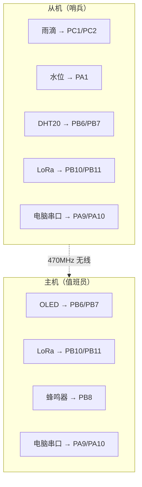

> **注意一个反差点**：从机的 PB6/PB7 接 DHT20，主机的 PB6/PB7 接 OLED。
> 同样是这两个引脚，接的东西不一样。因为**两台板子是完全独立的**，互不影响。

### 1.3 数据是怎么流动的

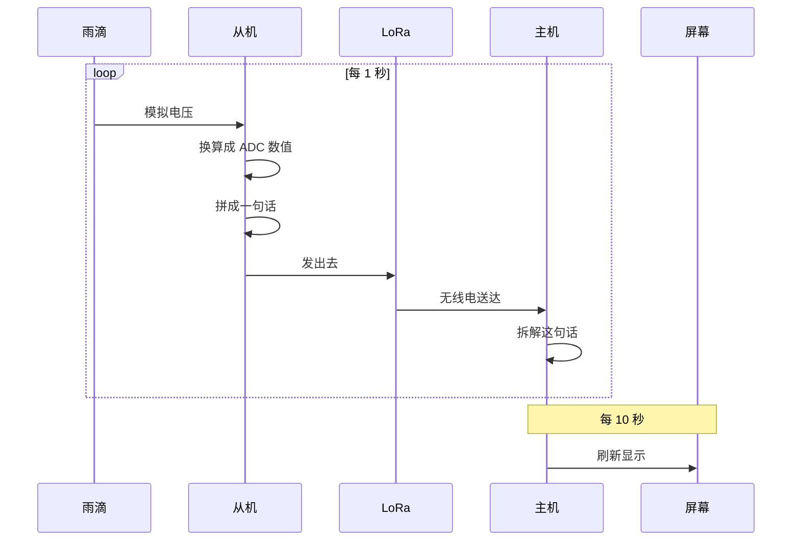

---

## 第 2 章 代码文件怎么分工

### 2.1 目录结构

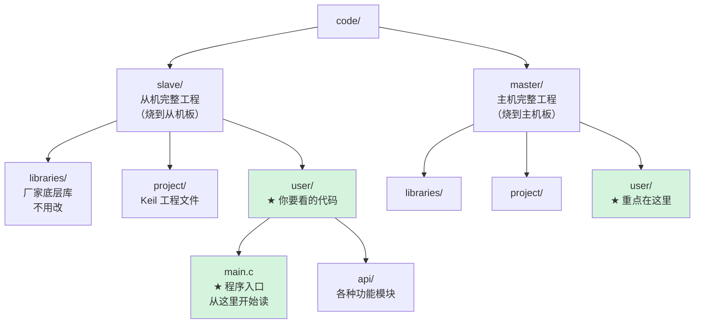

> **重点**：`libraries/` 是 ST 官方提供的底层驱动，**不用看**。
> 真正属于这个项目的代码，全在 `user/` 目录下。

### 2.2 从机文件职责

| 文件 | 干什么 | 类比 |
|---|---|---|
| `main.c` | 程序入口，主循环 | **总调度** |
| `api/sensor_report.c` | 采集三路 → 拼帧 → 发送 | **打包发货** |
| `api/raindrop.c` | 读雨滴传感器 | **量雨的尺子** |
| `api/level.c` | 读水位传感器 | **量水深的尺子** |
| `api/dht20.c` | 读温湿度 | **温度计** |
| `api/lora_as32.c` | 控制无线模块 | **对讲机操作手册** |
| `api/usart1.c` | 电脑串口（调试用） | **对讲机的喇叭** |
| `api/usart3.c` | LoRa 串口 | **对讲机的天线口** |
| `api/common.h` | 引脚、阈值的配置 | **设置清单** |
| `api/delay.c` | 延时函数 | **秒表** |
| `api/led.c` / `beep.c` | LED 和蜂鸣器 | **指示灯** |

### 2.3 主机文件职责

| 文件 | 干什么 | 类比 |
|---|---|---|
| `main.c` | 程序入口，主循环 | **总调度** |
| `api/frame_assembler.c` | **把碎片拼成完整句子** | **★ 最关键的翻译官** |
| `api/master_app.c` | 拆解数据 + 显示 | **翻译 + 抄写** |
| `api/oled.c` | 屏幕驱动 | **黑板** |
| `api/oled_font.c` | 汉字字库（856KB！） | **字典** |
| `api/i2c.c` | 软件 I2C（驱动屏幕） | **黑板和手的连接线** |

---

## 第 3 章 从机代码逐段拆解

### 3.1 main.c 的整体结构

打开 `code/slave/user/main.c`，它只有 **196 行**，结构非常清晰：

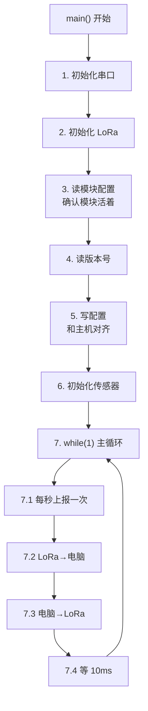

### 3.2 初始化阶段（第 1~6 步）

```c
USART1_Init(USART1_BRR); /* 串口1：接电脑，9600 波特率 */
LORA_Init(LORA_BRR);     /* 串口3：接 LoRa 模块 */
Beep_Init();
Led_Init();
```

**这段在做什么**：把要用的"外设"一个个打开。
就像开店前先把灯、空调、收银机都通电。

然后读 LoRa 模块的信息：

```c
if (LORA_ReadConfig(&config)) {
    USART1_SendString("LORA CONFIG : ");
    ...
}
```

**为什么要读**：如果模块没接好或者坏了，这里就会失败，
你能从电脑串口上看到 `LORA CONFIG READ FAIL`，**这就是排错的第一道关卡**。

接着**写配置**（这一步很重要）：

```c
config.addh   = 0x00;    /* 地址高字节 */
config.addl   = 0x00;    /* 地址低字节 */
config.speed  = LORA_UART_8N1 | LORA_UART_BAUD_9600 | LORA_AIR_SPEED_2K4;
config.chan   = LORA_DEFAULT_CHAN;   /* 信道 0x3D */
config.option = LORA_OPTION_TRANSPARENT;
LORA_SetConfig(&config);
```

> **⚠️ 这里必须和主机完全一致！**
> 地址、信道、空中速率、波特率，任何一项不同，两边就"对不上暗号"，收不到数据。
> 这是新手最常踩的坑。

最后初始化传感器：

```c
Report_Init();   /* 里面会调 RainDrop_GPIO_Init / Level_Init / DHT20_Init */
```

### 3.3 主循环（第 7 步）—— 程序的心脏

```c
while (1)
{
    /* 7.1 每 1 秒上报一次 */
    if (tick >= REPORT_INTERVAL_MS)
    {
        tick -= REPORT_INTERVAL_MS;
        Report_Once();                    /* ★ 核心：采集+组帧+发送 */
        Led0_Toggle;                      /* LED 翻一下，表示"我活着" */
        tick += REPORT_COST_ESTIMATE_MS;  /* 补偿耗时 */
    }

    /* 7.2 LoRa 收到数据 → 转发给电脑 */
    if (USART3_TakeFrame(s_rxBuf, &rxLen)) { ... }

    /* 7.3 电脑发来数据 → 转发给 LoRa */
    if (USART1_TakeFrame(s_rxBuf, &rxLen)) { ... }

    /* 7.4 等 10 毫秒，然后 tick 加 10 */
    delay_ms(LOOP_TICK_MS);
    tick += LOOP_TICK_MS;
}
```

**为什么要 `while(1)`**：单片机程序不能"结束"，必须一直跑。
一旦 `main()` 返回，程序就不知道跑哪去了。

**`tick` 是什么**：一个累加的毫秒计数器。
每轮循环 +10，累到 1000 就说明过了 1 秒，该上报了。

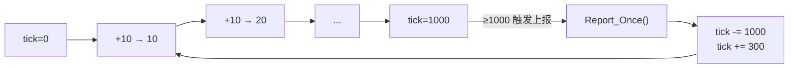

> **为什么 `tick -= 1000` 而不是 `tick = 0`**：
> 如果 `tick` 是 1005，直接清零就丢了 5ms；减去 1000 只丢 0，更准。
> 这是代码里 `[FIX-DBG4]` 注释在说的事。

### 3.4 Report_Once() —— 一次完整的上报

这是从机最核心的函数，只有 30 行，做了 4 件事：

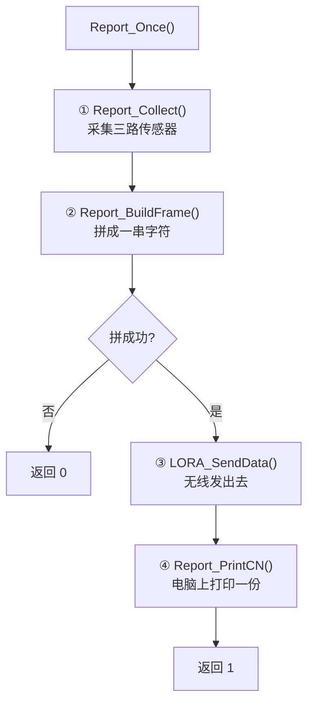

代码原文：

```c
uint8_t Report_Once(void)
{
    ReportData_t data;
    uint8_t  frame[REPORT_FRAME_MAX];
    uint16_t len;

    Report_Collect(&data);              /* ① 采集 */
    len = Report_BuildFrame(&data, frame);  /* ② 拼帧 */
    if (len == 0) return 0;

    LORA_SendData(frame, len);          /* ③ 发送 */
    Report_PrintCN(&data);              /* ④ 打印 */
    Report_PrintErr(&data);

    return 1;
}
```

### 3.5 Report_Collect() —— 采集三路传感器

```c
void Report_Collect(ReportData_t *pData)
{
    /* ① 雨滴：DO 消抖 + AO 滤波 + 换算等级 */
    RainDrop_GetData(&pData->rain);

    /* ② 水位：滤波 + 门限表换算 + 死区 */
    Level_Update();
    pData->level = level_value;

    /* ③ DHT20：失败重试一次 */
    for (attempt = 0; attempt < 2; attempt++) {
        pData->dht20Err = DHT20_Read(&pData->humidity, &pData->temperature);
        if (pData->dht20Err == DHT20_OK) {
            pData->dht20Ok = 1;
            break;
        }
        DHT20_Delay_ms(20);   /* 失败等 20ms 再试 */
    }

    /* 失败了给个安全值，别让结构体里是乱七八糟的数 */
    if (!pData->dht20Ok) {
        pData->temperature = 0.0f;
        pData->humidity    = 0.0f;
    }
}
```

**三个细节值得注意**：

| 细节 | 为什么这么做 |
|---|---|
| **ADC1 被两个传感器共用** | 雨滴用 PC2（通道 12），水位用 PA1（通道 1）。同一个 ADC，每次采样前必须**重新指定通道**，否则读到另一个的值 |
| **DHT20 重试一次** | 开漏 I2C 总线偶尔会没应答，隔 20ms 重试能救回来 |
| **失败给 0 而不是乱值** | 结构体如果不初始化，里面可能是随机垃圾数据，会导致显示异常 |

### 3.6 Report_BuildFrame() —— 拼出一句话

这是**通信协议**的核心。最终要拼成这样一串字符：

```
$RAIN,DHT20,T=26.5,H=52.2,ADC=4092,V=3297,WET=0,DO=1,LEVEL=0,WL=80*8B
```

**为什么用文本而不是二进制**：因为用串口助手直接就能看懂，
出问题时一眼就知道哪个字段不对，**调试成本最低**。

拼装过程是**一个字节一个字节往缓冲区里塞**：

```c
const char *prefix = "$RAIN,DHT20,T=";
while (*prefix != '\0') {
    pFrame[n++] = (uint8_t)(*prefix++);   /* 逐字符拷进去 */
}

/* 温度：26.5 → 输出 "26.5" */
if (pData->dht20Ok) {
    n += Report_Fixed1(&pFrame[n], pData->temperature);
} else {
    pFrame[n++] = '-';    /* 失败输出 "--" */
    pFrame[n++] = '-';
}
```

**最后加校验和**：

```c
bodyLen = n;
sum = Report_Checksum(pFrame, bodyLen);   /* 所有字节加起来，取低 8 位 */
pFrame[n++] = '*';
Report_Hex2(sum, &pFrame[n]);             /* 写成两位十六进制 */
```

> **校验和干什么用的**：接收方拿到数据后，自己再算一遍。
> 如果算出来和收到的不一样，说明**数据在传输中被干扰了**，直接丢弃。
> 就像寄快递时在箱子上写"共 5 件"，收到后数一下是不是 5 件。

### 3.7 三个传感器驱动在干什么

#### raindrop.c（雨滴）

```c
uint8_t RainDrop_GetData(RainData_t *pData)
```

做三件事：

| 步骤 | 说明 |
|---|---|
| 1. 读 DO | 数字量，只有 0 和 1。**消抖**：连续读 3 次都一样才算数 |
| 2. 读 AO | 模拟量，读 10 次取平均（**均值滤波**，抑制抖动） |
| 3. 判等级 | 按 ADC 值分档：>2500 无雨，2000~2500 小雨，1500~2000 中雨，≤1500 大雨 |

**为什么水越多 ADC 越小**：感应板上有水时导电性变好，输出电压降低。

#### level.c（水位）

这个最复杂，因为传感器**非线性**（水深的增加和 ADC 增加不成正比）。

```c
static const u16 level_threshold[LEVEL_SEGMENT_COUNT] =
{
    1100,   /* ADC >= 1100 → 100% */
     900,   /* ADC >=  900 →  90% */
     ...
     160    /* ADC >=  160 →  10% */
};
```

**用查表法而不是公式**：

```c
u8 Level_AdcToPercent(u16 adc)
{
    for (i = 0; i < LEVEL_SEGMENT_COUNT; i++) {
        if (adc >= level_threshold[i]) {
            return (u8)(100 - i * 10);   /* 第 i 段 → (100-i*10)% */
        }
    }
    return 0;   /* 都没命中 → 0% */
}
```

**还有一个"噪声死区"**（这是踩坑后加的）：

```c
/* 高度 ≤ 9mm 就强制归零 */
if (level_value.height <= LEVEL_IGNORE_BELOW_MM) {
    level_value.height  = 0;
    level_value.percent = 0;
}
```

> **为什么加这个**：传感器干燥时 ADC 会在 160~189 之间抖动，
> 落进 10% 档，而 `10% × 90mm = 9mm`，于是**没水也显示 9mm**。
> 加死区后这一档直接归零，问题解决。

#### dht20.c（温湿度）

```c
uint8_t DHT20_Read(float *humidity, float *temperature)
```

流程：

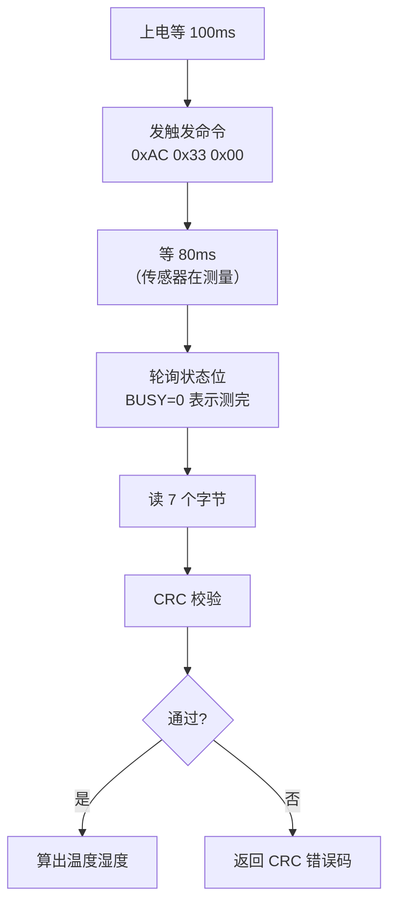

**关键点**：DHT20 是**软件模拟 I2C**（用普通 GPIO 引脚模拟时序），
不是硬件 I2C 外设。因为硬件 I2C 在 STM32F1 上有已知问题。

---

## 第 4 章 主机代码逐段拆解

### 4.1 主机和从机的本质区别

| | 从机 | 主机 |
|---|---|---|
| 主要工作 | **采集 + 发送** | **接收 + 显示** |
| 核心难点 | ADC 采样、传感器时序 | **把碎片拼成完整帧** |
| 有没有屏幕 | 没有 | 有（OLED） |
| 有没有告警 | 没有 | 有（蜂鸣器） |

> 主机**不接任何传感器**。它的 `sensor_report.c`、`raindrop.c` 等文件
> 是从机代码的副本，**实际不参与运行**，只是工程结构保持一致。

### 4.2 main.c 的整体结构

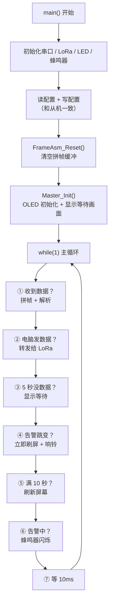

### 4.3 第 ① 步：收数据（最关键的 30 行）

```c
if (USART3_TakeFrame(s_rxBuf, &rxLen))
{
    if (rxLen > 0)
    {
        u16 frameLen = 0;

        while (FrameAsm_Push(&s_frameAsm, s_rxBuf, rxLen,
                             s_frameBuf, sizeof(s_frameBuf), &frameLen))
        {
            /* 拼出完整帧，打印到电脑 */
            USART1_SendString("[RX] ");
            USART1_SendBuffer(s_frameBuf, frameLen);

            /* 解析 */
            if (Master_ParseFrame(s_frameBuf, frameLen))
            {
                showingWait = 0;
                screenDirty = 1;    /* 只标脏，不立刻刷屏！ */
                Led0_Toggle;
            }
            else
            {
                USART1_SendString("[WARN] frame parse/checksum failed\r\n");
            }

            idleMs = 0;
            rxLen = 0;   /* 后续数据已在缓冲里，继续扫 */
        }
    }
}
```

**这段为什么要用 `while`**：
一次收到的数据里可能包含**多帧**（比如两帧粘在一起到了），
`while` 能一次把缓冲里所有完整帧都取出来。

**为什么 `rxLen = 0`**：
第一次调用已经把数据追加进拼帧器的缓冲了，
后续调用传 0，只是让拼帧器继续扫描缓冲里剩下的内容，不重复追加。

### 4.4 第 ④ 步：告警（这是设计得最巧的一段）

```c
if (master_data.waterAlarm != prevAlarm)    /* 状态变了！ */
{
    prevAlarm = master_data.waterAlarm;

    if (master_data.waterAlarm) {
        beepOn = 1;
        Beep_Ctrl(1);       /* 立即响，不等 500ms 计时 */
    } else {
        beepOn = 0;
        Beep_Ctrl(0);       /* 立即停 */
    }

    if (!showingWait) {
        screenMs = 0;
        Master_Display();   /* 立即刷屏，不等 10 秒周期 */
    }
}
```

**这里的思想叫"边沿触发"**：

| 触发方式 | 代码 | 结果 |
|---|---|---|
| 电平触发（❌ 不用） | `if (waterAlarm)` | 告警期间**每轮循环**都刷屏 → 屏幕疯狂闪烁 |
| **边沿触发（✅ 当前）** | `if (waterAlarm != prevAlarm)` | 只在**状态变化的那一瞬间**刷一次 → 屏幕稳定 |

> 就像门铃：按下去"叮咚"响一次就够了，不需要按着不放就一直响。

### 4.5 第 ⑤ 步：10 秒刷屏（数据与显示解耦）

```c
if ((screenMs >= SCREEN_REFRESH_MS) && screenDirty && (!showingWait))
{
    screenMs = 0;
    screenDirty = 0;
    Master_Display();
}
```

**核心思想**：**数据更新**和**屏幕刷新**是两件独立的事。

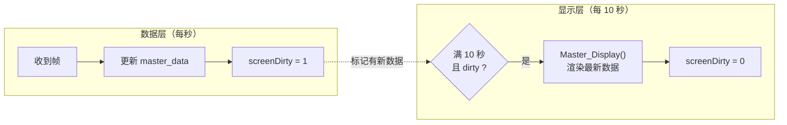

**为什么要这样**：

| 如果不解耦 | 后果 |
|---|---|
| 每收到一帧就刷屏 | 从机 1 秒一帧 → 屏幕每秒刷一次 → **OLED 明显闪烁** |
| 而且软件 I2C 刷一屏要几十毫秒 | 占满 CPU，影响收帧 |

**解耦后**：数据永远是最新的（内存里），但屏幕 10 秒才画一次，**又稳又不卡**。

### 4.6 第 ③ 步：断线保护

```c
idleMs += LOOP_TICK_MS;
if (idleMs >= RX_TIMEOUT_MS)     /* 5 秒没收到 */
{
    if (!showingWait) {
        Master_ShowWaiting();     /* 显示"等待从机" */
        showingWait = 1;

        /* ★ 必须清告警！ */
        master_data.waterAlarm = 0;
        prevAlarm = 0;
        beepOn = 0;
        beepMs = 0;
        Beep_Ctrl(0);
    }
    idleMs = RX_TIMEOUT_MS;
}
```

> **这段的坑**：如果断线前正在告警，`waterAlarm` 会一直保持 1，
> 蜂鸣器就会**无限期长响**。所以断线时必须手动清零。
> 这是实测发现并修复的 bug。

### 4.7 frame_assembler.c —— 主机最关键的模块

**这个文件解决的问题**：LoRa 模块会把一整帧**切成 32 字节一块**发出来。

```
完整一帧（71 字节）：
$RAIN,DHT20,T=26.5,H=52.2,ADC=4092,V=3297,WET=0,DO=1,LEVEL=0,WL=80*8B

实际收到的（3 块）：
块1: $RAIN,DHT20,T=26.5,H=52.2,A        ← 32 字节
块2: DC=4092,V=3297,WET=0,DO=1,LEVEL    ← 32 字节
块3: =0,WL=80*8B                         ← 7 字节
```

**如果每块都当一帧去解析 → 必然失败**（找不到完整帧头和校验和）。

**拼帧器怎么解决**：像拼图一样，先攒起来，等攒齐了再交出去。

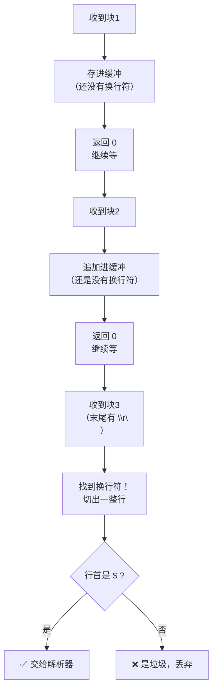

**三个保护措施**（都是踩坑后加的）：

| 保护 | 代码 | 防的是什么 |
|---|---|---|
| 行首必须是 `$` | `if (fa->buf[0] != FRAME_START_CHAR)` | 半截残留 `=0,WL=80*8E` 会和新帧粘连 |
| 缓冲无 `$` 就清空 | 扫描找 `$`，找不到就清零 | 垃圾流永远等不到换行，**堵死缓冲** |
| 缓冲满了清空 | `if (fa->len >= 容量) fa->len = 0` | 防止数组越界 |

### 4.8 master_app.c 的解析函数

`Master_ParseFrame()` 干的事：

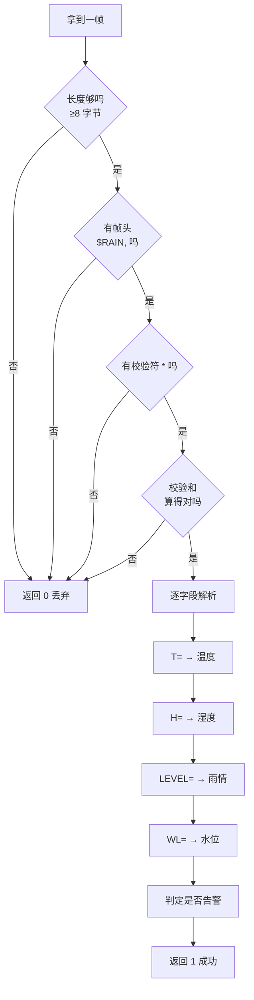

**解析的巧思**：不依赖字段顺序，而是**按名字找**。

```c
p = FindSub(frame, bodyLen, "WL=", 3);   /* 找 "WL=" 这三个字符 */
if (p >= 0) {
    v = ParseUInt(frame, bodyLen, p + 3, &ok);   /* 从 "=" 后面开始读数字 */
}
```

> **好处**：以后从机增加字段或调整顺序，主机不用改代码 ——
> 认识的字段就读，不认识的就忽略。这叫**向后兼容**。

---

## 第 5 章 两个必须懂的硬核概念

### 5.1 概念一：ADC 是什么

**ADC = Analog to Digital Converter（模数转换器）**

单片机的引脚只能读"数字"（0V 或 3.3V）。
但传感器输出的是**连续变化的电压**（比如 0.5V、1.2V、2.8V）。

ADC 的作用：**把电压翻译成数字**。

| 实际电压 | ADC 读数（12 位） |
|---|---|
| 0 V | 0 |
| 1.65 V（一半） | ≈ 2048 |
| 3.3 V | 4095 |

**为什么是 0~4095**：12 位 ADC，2¹² = 4096 个刻度。

```
ADC 读数 = 电压(mV) × 4095 / 3300
```

**本工程的两路 ADC**：

| 传感器 | 引脚 | ADC 通道 | 特点 |
|---|---|---|---|
| 雨滴 | PC2 | ADC1_IN12 | 水越多 ADC **越小** |
| 水位 | PA1 | ADC1_IN1 | 水越多 ADC **越大** |

> **注意两个传感器方向相反**！雨滴是"湿了电压降"，水位是"深了电压升"。
> 这是硬件特性决定的，写代码时容易搞混。

### 5.2 概念二：为什么会有"中断"和"缓冲区"

**问题**：主循环在做别的事（比如刷屏、延时），
但串口随时可能收到数据。**不能错过！**

**解决**：用**中断**。

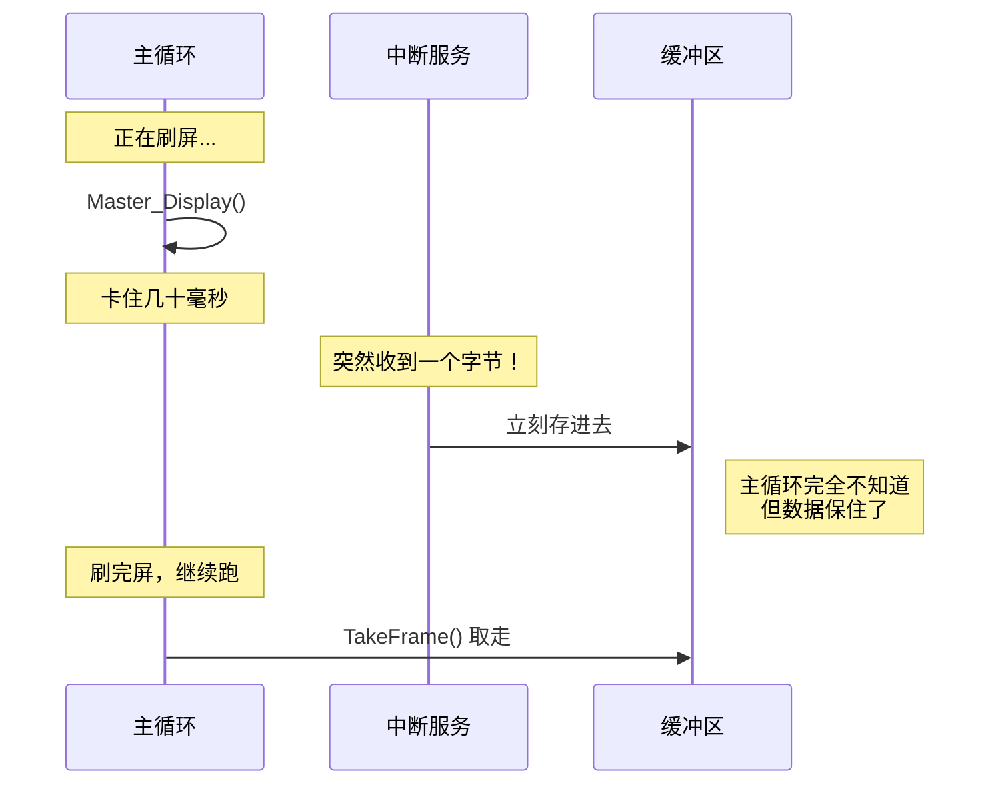

**中断的本质**：CPU 放下手头的事，**立刻**去处理紧急情况，处理完再回来。

**为什么需要 `TakeFrame()` 这个函数**：

```c
static __inline u8 USART3_TakeFrame(u8 *dst, u16 *pLen)
{
    u8 got = 0;
    __disable_irq();          /* ① 关中断 */
    if (usart3_value.flag) {
        *pLen = usart3_value.count;
        memcpy(dst, usart3_value.data, usart3_value.count);  /* ② 拷贝 */
        memset(&usart3_value, 0, sizeof(USART3_Data));       /* ③ 清空 */
        got = 1;
    }
    __enable_irq();           /* ④ 开中断 */
    return got;
}
```

**这四步在防什么**：

如果不用关中断：

```
主循环：我看看 flag = 1，好，开始 memset 清空...
        ↓
中断：  等等！我刚收到新的一帧，正在往缓冲里写！
        ↓
主循环：清空完了（把刚收到的数据也清了）
        ↓
结果：  丢帧！
```

**关中断 = 告诉中断"等一下，我这边处理完你再进来"**，
保证拷贝和清空这两个动作之间不会被打断。

---

## 第 6 章 读代码的正确顺序

### 6.1 不要从头到尾读！

新手最容易犯的错：打开 `main.c` 从第 1 行开始读，
读到 `RCC->APB2ENR |= ...` 就懵了。

**正确的读法**：**先看骨架，再看肌肉**。

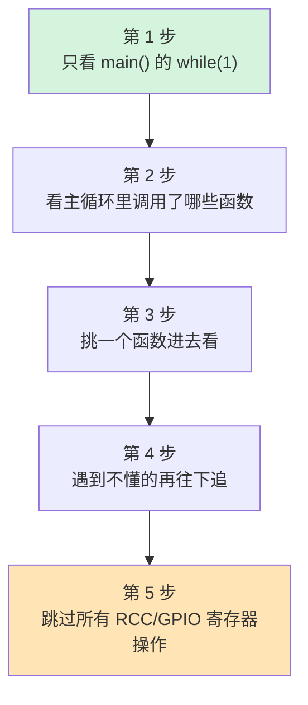

### 6.2 推荐路线（从机）

| 顺序 | 看什么 | 目标 |
|---|---|---|
| 1 | `main.c` 的 `while(1)` 部分 | 知道主循环干哪几件事 |
| 2 | `sensor_report.c` 的 `Report_Once()` | 知道一次上报的完整流程 |
| 3 | `sensor_report.c` 的 `Report_BuildFrame()` | 知道帧是怎么拼出来的 |
| 4 | `raindrop.c` 的 `RainDrop_GetData()` | 看一个简单的传感器驱动 |
| 5 | `level.c` 的 `Level_Update()` | 看查表法 |
| 6 | `dht20.c` | 跳过（I2C 时序太细，初学不用深究） |
| 7 | `usart1.c` / `usart3.c` | 只关心 `TakeFrame` 和 `SendBuffer` |

### 6.3 推荐路线（主机）

| 顺序 | 看什么 | 目标 |
|---|---|---|
| 1 | `main.c` 的 `while(1)` | 知道主循环干哪几件事 |
| 2 | `main.c` 第 ① 步收数据那段 | **理解拼帧的调用方式** |
| 3 | `frame_assembler.c` 的 `FrameAsm_Push()` | **理解拼帧算法（最重要）** |
| 4 | `master_app.c` 的 `Master_ParseFrame()` | 理解解析 |
| 5 | `master_app.c` 的 `Master_Display()` | 理解显示 |
| 6 | `main.c` 第 ④ 步告警 | 理解边沿触发 |
| 7 | `oled.c` | 跳过（SSD1306 驱动，不用深究） |

### 6.4 可以安全跳过的部分

| 内容 | 为什么可以跳过 |
|---|---|
| `libraries/` 整个目录 | ST 官方库，几万行，跟业务无关 |
| 所有 `RCC->xxx` 寄存器操作 | 只是"开时钟"，照抄就行 |
| 所有 `GPIO_Init` 配置 | 只是"配引脚"，照抄就行 |
| `dht20.c` 的 I2C 时序 | 位操作模拟时序，初学不必深究 |
| `oled.c` 的初始化序列 | SSD1306 手册规定的固定命令，照抄就行 |
| `oled_font.c` | 856KB 的字模数据，纯数据文件 |

---

## 第 7 章 常见疑问解答

### Q1：为什么有两个 `main.c`？

因为**两个独立工程**，各自烧到不同的板子上。

- `code/slave/user/main.c` → 烧到从机板
- `code/master/user/main.c` → 烧到主机板

### Q2：为什么主机工程里也有 `raindrop.c`、`dht20.c`？

因为主机工程是**从从机工程复制过来的**，保留了这些文件但**不调用它们**。

验证方法：看 `code/master/project/STM32F103ZET6_Project.uvprojx` 里
虽然注册了这些文件，但 `main.c` 里没有任何地方调用它们。

> 这是工程结构的一致性考虑，不影响功能，只是多占一点 Flash。

### Q3：为什么帧要用 `$` 开头、`\r\n` 结尾？

- `$` 开头：**标记帧的开始**，用来判断"这是不是一帧新数据"
- `\r\n` 结尾：**标记帧的结束**，拼帧器靠它找边界

就像写信：开头"亲爱的"，结尾"此致敬礼"，中间才是正文。

### Q4：为什么校验和是"累加"而不是更复杂的算法？

因为**够用**：

- LoRa 物理层本身有纠错能力，误码率很低
- 累加和能检出单字节错误和多数多字节错误
- 代码只有 5 行，比 CRC 简单得多

> 累加和的弱点：不检测字节顺序错乱（交换两个字节和不变）。
> 但 LoRa 不会乱序，所以可接受。

### Q5：为什么屏幕 10 秒才刷一次？数据不是 1 秒一帧吗？

**数据是实时的**（每秒都更新到内存 `master_data`），
**屏幕是节流的**（10 秒才画一次）。

原因：OLED 通过软件 I2C 刷新一屏需要几十毫秒，
每秒刷一次会**明显闪烁**，还会占用大量 CPU。

**但告警是例外** —— 水位超限时**立即**刷屏，不等 10 秒。

### Q6：`volatile` 是什么？为什么有些变量要加？

`volatile` 告诉编译器："**这个变量可能被意想不到的地方改变，别优化它**"。

典型场景：中断服务函数和主循环共享的变量。

```c
/* 中断里会改这个变量 */
volatile u8 usart3_flag;
```

如果没加 `volatile`，编译器可能把变量缓存到寄存器里，
主循环就永远看不到中断的修改 → **死循环等不到数据**。

### Q7：为什么有的地方用 `u8`，有的用 `uint8_t`？

**两者完全一样**，都是"8 位无符号整数"（0~255）。

`u8` / `u16` / `u32` 是 `common.h` 里自己定义的简写：

```c
typedef unsigned char  u8;
typedef unsigned short u16;
typedef unsigned int   u32;
```

`uint8_t` / `uint16_t` 是 C 标准库 `<stdint.h>` 里的定义。

**本工程混用了**，看到别困惑，是同一个东西。

### Q8：`static` 是什么意思？

三个用途，本工程都用到了：

| 用法 | 含义 | 例子 |
|---|---|---|
| 修饰函数 | **只能在本文件内调用** | `static void Report_PrintCN(...)` |
| 修饰全局变量 | **只能在本文件内访问** | `static u8 s_rxBuf[256]` |
| 修饰局部变量 | **函数结束后值还在** | 少见，本工程未用 |

> 好处：避免命名冲突，也告诉读代码的人"这个函数是内部用的，外部别调"。

### Q9：为什么缓冲区都要加 `static`？

因为**栈只有 1KB**！

```c
/* ❌ 危险：放栈上，256 字节 */
void foo(void) {
    u8 buf[256];
}

/* ✅ 正确：放静态区（.bss） */
static u8 s_rxBuf[256];
```

**栈**是函数调用时临时用的空间，只有 1KB。
如果局部变量太大，会**栈溢出**，踩坏别的数据，程序行为诡异。

**静态区**（`.bss`）是全局的，空间大得多（有 64KB RAM），
放缓冲区最安全。

### Q10：如果我要加一个新传感器，怎么改？

按这个流程：

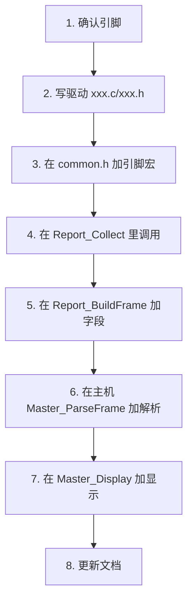

**关键点**：
- **从机加字段**后，主机的解析器**不用改也能工作**（不认识的字段自动忽略）
- 但**要显示**就得改主机的 `Master_ParseFrame` 和 `Master_Display`

---

## 第 8 章 名词速查表

### 8.1 硬件相关

| 名词 | 全称 | 是什么 |
|---|---|---|
| **MCU** | Microcontroller Unit | 单片机，这个项目的"大脑" |
| **STM32F103ZET6** | — | 具体型号，Cortex-M3 内核，512KB Flash，64KB RAM |
| **GPIO** | General Purpose Input/Output | 通用输入输出引脚，能读能写 |
| **ADC** | Analog to Digital Converter | 模数转换器，把电压变成数字 |
| **UART/USART** | Universal (Synchronous) Asynchronous Receiver/Transmitter | 串口，两块芯片通信的基本方式 |
| **I2C** | Inter-Integrated Circuit | 一种两线通信协议（SCL + SDA） |
| **DMA** | Direct Memory Access | 直接内存访问，不占 CPU 就能搬数据 |
| **LoRa** | Long Range | 一种远距离低功耗无线技术 |
| **OLED** | Organic Light-Emitting Diode | 有机发光二极管屏幕 |
| **SSD1306** | — | OLED 屏的驱动芯片型号 |

### 8.2 软件相关

| 名词 | 含义 |
|---|---|
| **寄存器** | 芯片内部的可读写"开关面板"，直接操作硬件 |
| **中断** | CPU 被打断去做更紧急的事 |
| **ISR** | Interrupt Service Routine，中断服务函数 |
| **轮询** | 不停地检查状态（vs 中断是"被通知"） |
| **消抖** | 连续读多次确认，避免信号抖动误判 |
| **滤波** | 多次采样取平均，抑制噪声 |
| **校验和** | 数据完整性检查，收发双方都算一遍比对 |
| **帧** | 一次完整的数据包 |
| **帧头/帧尾** | 数据包的开始/结束标记 |
| **拼帧** | 把碎片数据重组成完整帧 |
| **缓冲区** | 临时存放数据的内存区域 |
| **栈 / .bss** | 内存的两个区域，前者小（1KB），后者大（64KB） |
| **边沿触发** | 只在状态变化瞬间响应（vs 电平触发持续响应） |
| **解耦** | 把两件事分开，互不干扰 |

### 8.3 本工程专有名词

| 名词 | 含义 | 在哪 |
|---|---|---|
| **从机 / Slave** | 采集并发送数据的板子 | `code/slave/` |
| **主机 / Master** | 接收并显示的板子 | `code/master/` |
| **上报** | 从机主动发数据给主机 | `Report_Once()` |
| **告警** | 水位超阈值时响铃 | `waterAlarm` |
| **死区** | 低于某个值就当作 0 | `LEVEL_IGNORE_BELOW_MM` |
| **拼帧器** | 把 32 字节碎片拼成完整帧 | `frame_assembler.c` |
| **脏标记** | 标记"有新数据待显示" | `screenDirty` |
| **等待画面** | 断线时显示的"等待从机" | `Master_ShowWaiting()` |

---

## 附录：一页纸速记

如果只想记住最核心的，记住这些：

### 从机做 3 件事

```
1. 每 1 秒采集三路传感器（雨滴 / 水位 / 温湿度）
2. 拼成一句话（ASCII 文本帧 + 校验和）
3. 通过 LoRa 无线发出去
```

### 主机做 3 件事

```
1. 收数据 → 拼帧（32 字节碎片 → 完整帧）→ 校验 → 解析
2. 每 10 秒刷一次 OLED（4 行：温度/湿度/水位/雨情）
3. 水位 > 70% 立即响铃 + 显示"水位过高"（不等 10 秒）
```

### 三个最容易踩的坑

| 坑 | 现象 | 原因 |
|---|---|---|
| **帧被拆碎片** | 屏幕一直 `温度:--` | LoRa 按 32 字节分块，必须拼帧 |
| **I2C 没上拉** | OLED 不亮 / DHT20 读不到 | 开漏输出必须有 4.7K~10K 上拉 |
| **P10 跳线帽没拔** | 水位乱跳 | PA1 被 TPAD 电路干扰 |

### 三个设计精髓

| 精髓 | 在哪 | 好处 |
|---|---|---|
| **数据与显示解耦** | `screenDirty` 标记 | 数据实时，屏幕不闪 |
| **边沿触发告警** | `waterAlarm != prevAlarm` | 告警立即，屏幕稳定 |
| **流式拼帧** | `frame_assembler.c` | 解决 LoRa 碎片问题 |

---

## 读完这份文档，你应该能回答

- [ ] 这个项目为什么要两块板子？
- [ ] 从机每秒做哪几件事？
- [ ] 主机为什么不能直接把收到的数据当一帧解析？
- [ ] 校验和是干什么用的？
- [ ] 为什么屏幕 10 秒才刷一次，但告警能立即显示？
- [ ] ADC 是什么？为什么雨滴和水位的方向相反？
- [ ] `TakeFrame()` 里为什么要关中断？
- [ ] 为什么缓冲区要放静态区而不是栈上？

**全部答得出来 = 你已经看懂这个代码了。**

---

## 下一步建议

| 想做什么 | 建议 |
|---|---|
| **只想跑起来** | 按 `docs/开发环境.md` 编译烧录 |
| **想改参数** | 看 `docs/参数配置.md` |
| **想深入原理** | 看 `docs/系统设计.md` |
| **遇到问题** | 查 `docs/故障排查.md` |
| **想改硬件** | 看 `docs/硬件规格.md` |
| **想改协议** | 看 `docs/通信协议.md` |
