# 故障排查

> 现象 → 原因 → 解决

---

## 目录

- [1 快速定位](#1-快速定位)
- [2 从机故障](#2-从机故障)
- [3 主机故障](#3-主机故障)
- [4 通信故障](#4-通信故障)
- [5 传感器故障](#5-传感器故障)
- [6 编译故障](#6-编译故障)
- [7 已修复的历史问题](#7-已修复的历史问题)
- [8 分段验证法](#8-分段验证法)

---

## 1 快速定位

### 1.1 先看两个串口

**这是最快的定位手段。**

| 板子 | 正常输出 | 说明 |
|---|---|---|
| 从机 | `温度:26.4℃,湿度:49.6%,无雨,水位:80%(ADC=716)` 每秒一行 | 采集 + 发送正常 |
| 主机 | `[RX] $RAIN,DHT20,T=26.5,...` | 收帧 + 拼帧正常 |

**串口设置**：9600 8N1，**编码 GBK**。

### 1.2 故障定位决策树

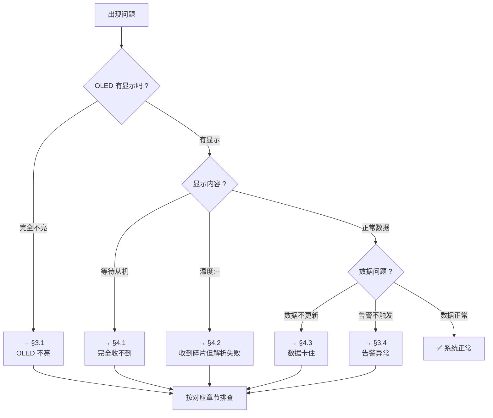

### 1.3 LED 指示

| 板子 | LED0 翻转时机 | 不翻转说明 |
|---|---|---|
| 从机 | 每上报一次（1 秒） | 程序没进上报分支 |
| 主机 | 每收到一帧有效数据 | 没收到有效帧 |

---

## 2 从机故障

### 2.1 从机串口无任何输出

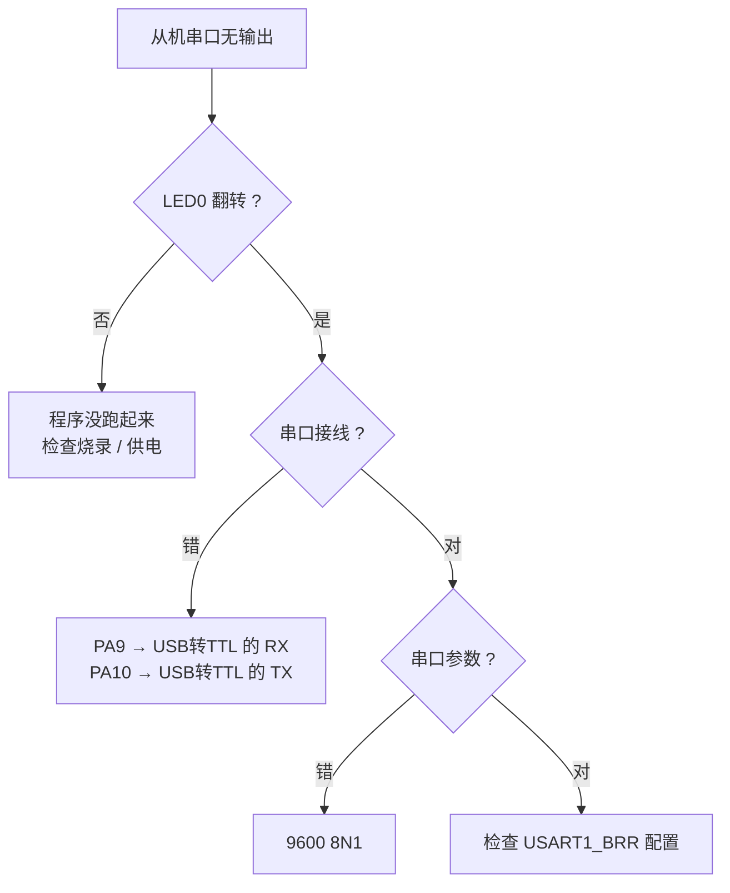

| 检查项 | 方法 |
|---|---|
| 程序是否在跑 | LED0 是否翻转 |
| 串口接线 | PA9(MCU TX) → USB转TTL 的 RX |
| 串口参数 | 9600 8N1 |
| 波特率是否匹配 | `USART1_BRR = 9600` |
| 板子是否上电 | 电源指示灯 |

### 2.2 从机串口输出但无 LoRa 发送

**看启动信息**：

```
LORA CONFIG : C0 00 00 1A 3D 40      ← 正常
LORA VERSION : AS32-TTL-100-C-V9.0   ← 正常
LORA CONFIG SET OK                    ← 正常
```

如果出现 `LORA CONFIG READ FAIL`，见 [§4.4](#44-lora-config-read-fail)。

### 2.3 上报周期不准

**现象**：串口输出间隔明显大于 1 秒。

**原因**：`delay_ms()` 是纯软件循环，`-O0` 下实际约 10.8ms（标称 10ms），
累积偏差约 8%。

**处理**：可接受，无需修改。要精确需改用硬件定时器。

### 2.4 `温度:--`

**原因**：DHT20 读取失败。

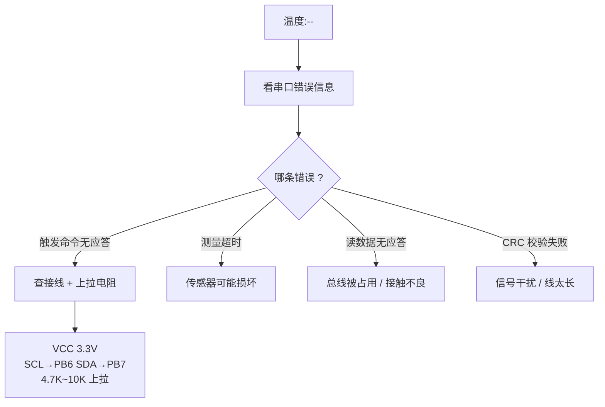

**串口会打印具体原因**：

```
[错误] DHT20 触发命令无应答(检查 SCL=PB6 SDA=PB7 接线与上拉)
[错误] DHT20 测量超时(传感器可能损坏)
[错误] DHT20 读数据无应答(总线被占用或接触不良)
[错误] DHT20 CRC 校验失败(信号干扰或线太长)
```

### 2.5 `水位:--`

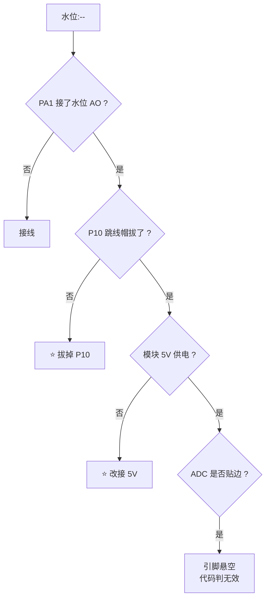

| 检查项 | 说明 |
|---|---|
| PA1 是否接了水位模块 AO | |
| **P10 跳线帽是否拔掉** | PA1 兼作 TPAD 触摸脚，不拔会干扰 |
| 模块是否 **5V** 供电 | 3.3V 会导致输出幅度不足 |
| ADC 是否贴边 | 完全不变且 ≤10 或 ≥4085 会判无效 |

### 2.6 水位读数乱跳

**首要原因**：**P10 跳线帽没拔**。

PA1 在开发板上兼作 TPAD 触摸检测脚，不拔跳线帽时 TPAD 电路会干扰 ADC 读数。

**处理**：拔掉 P10 跳线帽。

### 2.7 没水也报 9mm（已修复）

**现象**：干燥时一直显示 `水位:9mm`。

**根因**：


**已修复**：加了噪声死区 `LEVEL_IGNORE_BELOW_MM = 9`，
`height ≤ 9mm` 时强制归零。

**如果仍有**：把 `level.h` 的 `LEVEL_IGNORE_BELOW_MM` 调大：

```c
#define LEVEL_IGNORE_BELOW_MM (18)   /* 9 -> 18，忽略整个 20% 档 */
```

### 2.8 满水只显示 60%（需标定）

**现象**：水位传感器满水，但显示只有 60~80%。

**根因**：门限表与实际传感器量程不匹配。

| 项 | 值 |
|---|---|
| 门限表要求（100%） | ADC ≥ **1100** |
| 实测满水 ADC | ≈ **716** |
| 结果 | 只能到 80% |

**处理**：按实测 ADC 重新标定门限表，见
[参数配置 §5](参数配置.md#5-水位门限标定)。

**快速判断**：看从机串口的 `(ADC=xxx)`：

```
满水时 ADC=716  → 门限表要 1100 才算 100%，所以显示 80%
```

### 2.9 雨情一直"无雨"

**正常**：干燥时 ADC 约 2900~3500，判无雨是正确的。

**测试方法**：滴一滴水在感应板，看 ADC 是否下降。

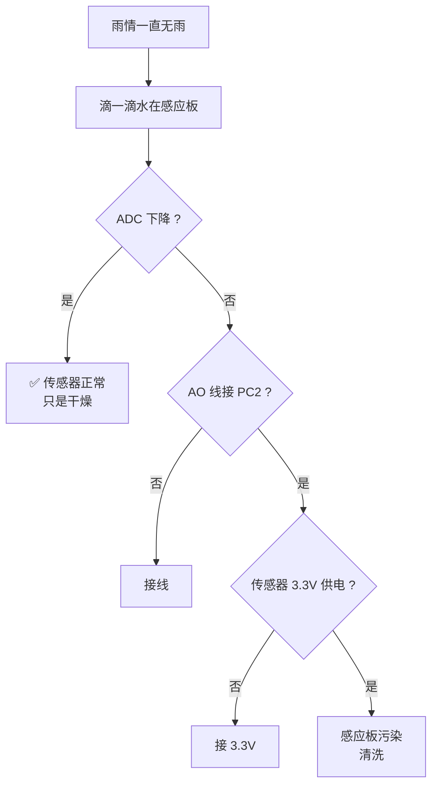

---

## 3 主机故障

### 3.1 OLED 完全不亮

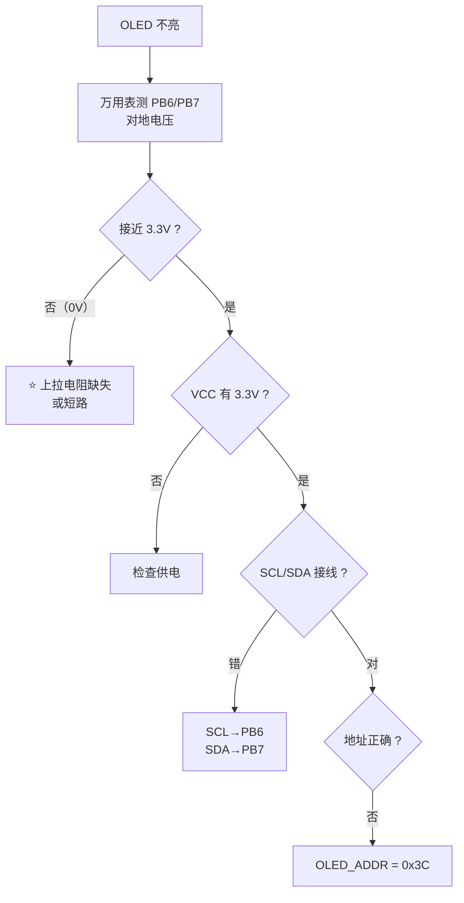

| 检查项 | 方法 |
|---|---|
| VCC / GND | 3.3V |
| SCL → **PB6** | |
| SDA → **PB7** | |
| **上拉电阻** | **必须有 4.7K~10K 到 3.3V** |
| I2C 地址 | `OLED_ADDR = 0x3C` |
| 用万用表测 PB6/PB7 | 静态应接近 3.3V（有上拉） |

### 3.2 OLED 显示方块/乱码

| 检查项 | 说明 |
|---|---|
| `OLED_USE_FONT` | 必须是 **1**（`oled_font.h`） |
| 文件编码 | `master_app.c` 必须是 **GBK** |
| 字库是否覆盖 | 只支持 GB2312 一级汉字（3755 字） |

**验证 `OLED_USE_FONT`**：

```c
/* code/master/user/api/oled_font.h */
#define OLED_USE_FONT   1    ← 必须是 1
```

**验证编码**：

```python
b = open('master_app.c','rb').read()
b.decode('gbk')   # 不报错 = GBK 正常
```

如果 `OLED_USE_FONT = 0`，`RO-data` 会只有 498 B 而不是 122206 B。
看编译日志可快速判断。

### 3.3 屏幕一直"等待从机"

**说明完全没收到有效帧**（或超时 5 秒）。

见 [§4.1](#41-完全收不到数据)。

### 3.4 告警异常

#### 告警不触发

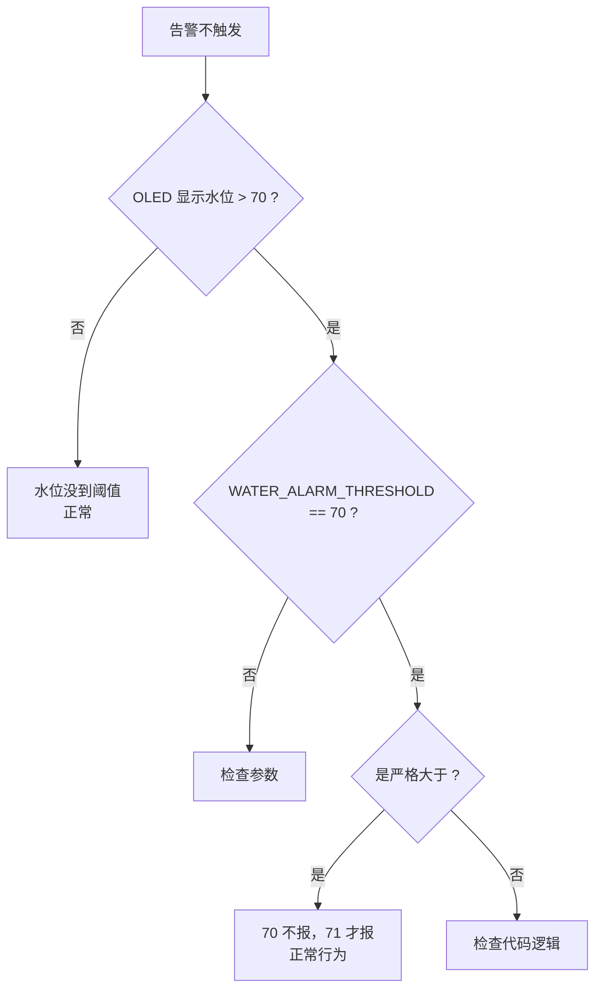

| 检查项 | 说明 |
|---|---|
| 水位是否真超 70% | 看 OLED `水位:xx%` |
| 阈值是否正确 | `WATER_ALARM_THRESHOLD = 70` |
| 是**严格大于** | 70 不报，71 才报 |

#### 蜂鸣器一直响不停

**根因**：断线后 `waterAlarm` 保持旧值，蜂鸣器无限长响。

**已修复**：超时分支会清告警 + 关蜂鸣器。

```c
/* main.c 超时分支 */
master_data.waterAlarm = 0;
prevAlarm = 0;
beepOn = 0;
beepMs = 0;
Beep_Ctrl(0);
```

**如果仍在响**：检查超时分支是否真的执行（`RX_TIMEOUT_MS = 5000`）。

#### 告警延迟很久才显示

**根因**：只标脏不立即刷屏，要等 10 秒周期。

**已修复**：改为边沿触发，跳变瞬间立即刷屏。

**验证**：水位刚超 70% 时，OLED 应在 **1 秒内**（下一帧到达）变成
`水位:xx%!` + `水位过高`。

### 3.5 屏幕刷新太慢

**正常行为**：10 秒刷一次（`OLED_REFRESH_MS = 10000`）。

**数据是实时的**（每秒更新到内存），只是屏幕渲染有 10 秒节流。

想更快：改 `master_app.h` 的 `OLED_REFRESH_MS`。

### 3.6 主循环卡顿

**原因**：串口打印阻塞。

`USART1_SendBuffer()` 只有一个 DMA 缓冲，每次调用前要等上一帧发完。
9600bps 下 71 字节约 74ms。

**已修复**：先拼成一个缓冲再发，避免 3 次调用白等 150ms。

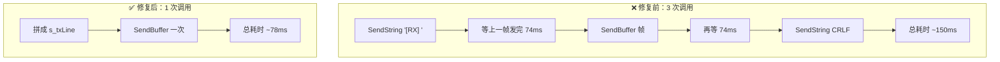

---

## 4 通信故障

### 4.1 完全收不到数据

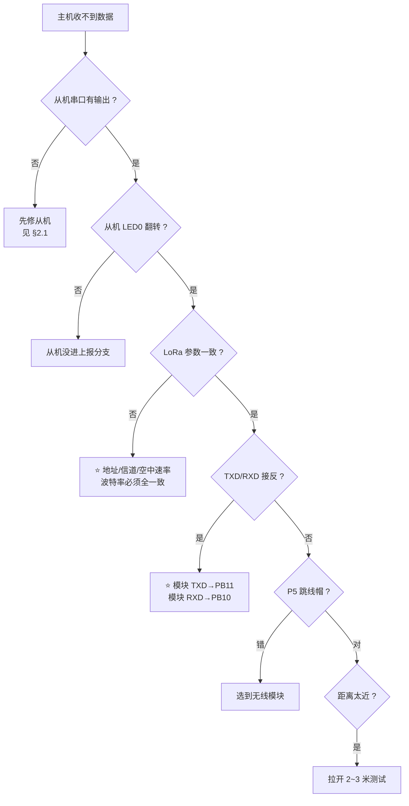

**从机侧确认**：

| 检查项 | 方法 |
|---|---|
| 从机是否在发 | 从机串口每秒有输出 |
| 从机 LED0 | 每秒翻转 |

**LoRa 参数确认**（两机必须完全一致）：

| 参数 | 从机 | 主机 |
|---|---|---|
| 地址 | 0x0000 | 0x0000 |
| 信道 | 0x3D | 0x3D |
| 串口波特率 | 9600 | 9600 |
| 空中速率 | 2.4k | 2.4k |
| 模式 | 透明 | 透明 |

**接线确认**：

```
模块 TXD → PB11（MCU 的 RX）
模块 RXD → PB10（MCU 的 TX）
```

> **接反的现象**：`LORA CONFIG READ FAIL`

**跳线帽**：P5 必须选到无线模块。

**距离**：两机相距太近（< 1m）时信号过强可能反而收不到，
拉开 **2~3 米**测试。

### 4.2 收到碎片但解析失败（已修复）

**现象**：

```
[RX] $RAIN,DHT20,T=26.5,H=52.2,A        ← 32 字节
DC=4092,V=3297,WET=0,DO=1,LEVEL         ← 32 字节
[RX] =0,WL=80*8B                         ← 7 字节
[WARN] frame parse/checksum failed, ignored
```

屏幕显示 `温度:--`。

**根因**：AS32-TTL-100-C 模块把一帧拆成 32 字节碎片输出，
每次 IDLE 中断收到的只是碎片。

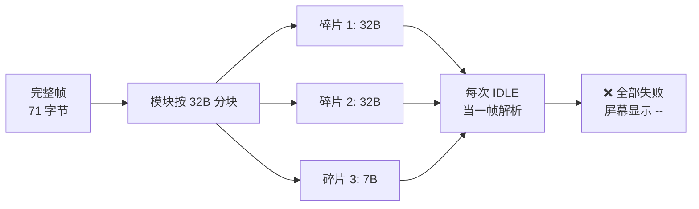

**已修复**：新增 `frame_assembler.c` 流式拼帧器。

**验证修复**：主机串口 `[RX]` 行应该是**完整 71 字节**：

```
[RX] $RAIN,DHT20,T=26.5,H=52.2,ADC=4092,V=3297,WET=0,DO=1,LEVEL=0,WL=80*8B
```

**如果仍是碎片**：

| 检查项 | 说明 |
|---|---|
| `frame_assembler.c` 是否注册 | 看编译日志有没有 `compiling frame_assembler.c...` |
| `main.c` 是否用了 `FrameAsm_Push()` | |
| 拼帧缓冲是否太小 | `FRAME_ASM_BUF_SIZE = 256` 够用 |

### 4.3 偶发 `[WARN] frame parse/checksum failed`

**原因**：串口误码导致校验和不符。

**正常**：偶发（几分钟一次）可忽略，下一帧自然补上。

**频繁**（每秒都报）说明：

| 检查项 | 说明 |
|---|---|
| 帧被截断 | 拼帧缓冲太小 |
| 双端校验算法不一致 | 检查代码版本是否一致 |
| 供电不稳 | LoRa 发射瞬间 200mA，电压跌落导致数据错 |

### 4.4 `LORA CONFIG READ FAIL`

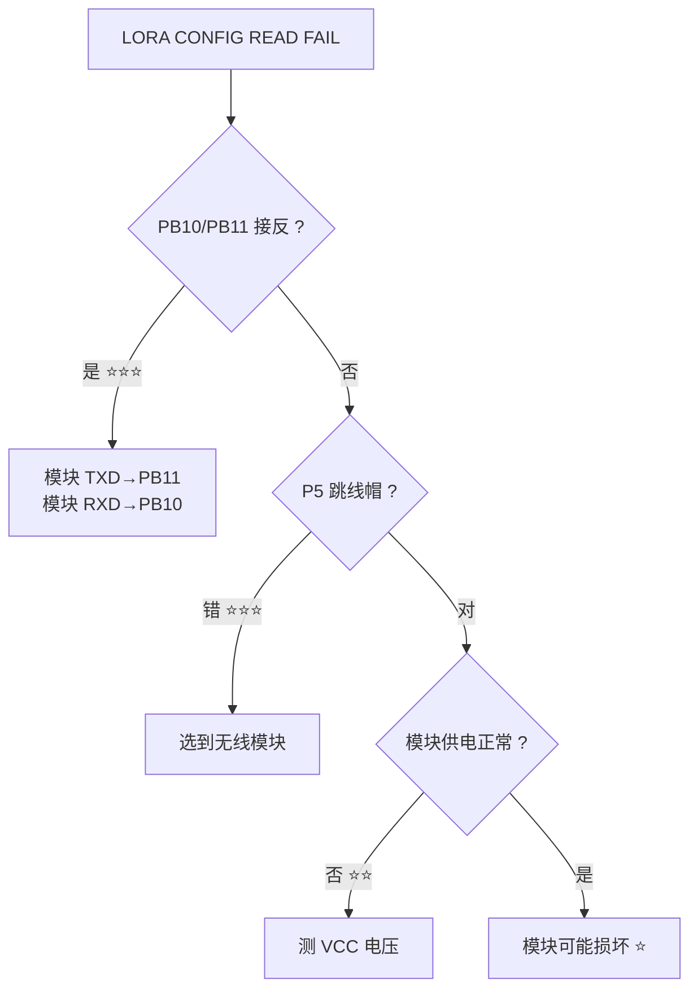

| 检查项 | 优先级 |
|---|---|
| **PB10/PB11 是否接反** | ⭐⭐⭐ 最常见 |
| P5 跳线帽是否选到无线模块 | ⭐⭐⭐ |
| 模块供电是否正常 | ⭐⭐ |
| 模块是否损坏 | ⭐ |

**接线正确姿势**：

```
模块 TXD → MCU PB11（RX）
模块 RXD → MCU PB10（TX）
```

### 4.5 数据能收到但水位显示 `--`

**原因**：从机固件太老，帧里没有 `WL=` 字段。

**验证**：看主机串口 `[RX]` 行：

| 情况 | 说明 |
|---|---|
| 有 `WL=` | 从机固件新，正常 |
| 无 `WL=` | 从机固件老，需重新烧录 |

**处理**：重新烧录从机固件。

---

## 5 传感器故障

### 5.1 雨滴 ADC 恒为 4095 不动

**原因**：AO 引脚悬空或没接。

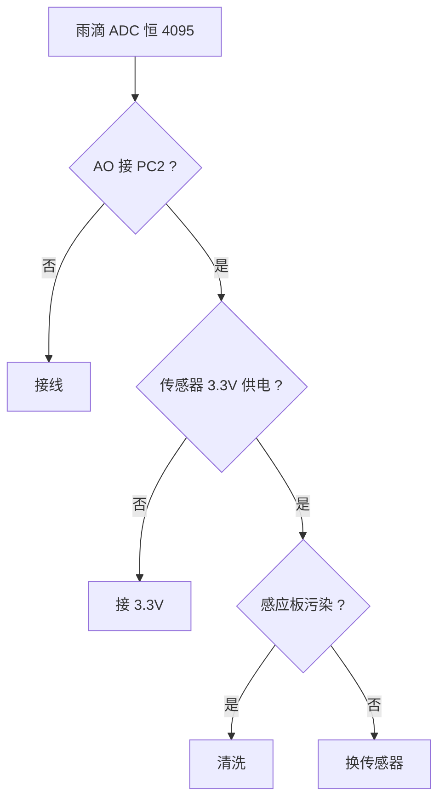

**历史记录**：早期用 PC0（ADC1_IN10），实测恒为 4095（悬空），已改用 PC2。

### 5.2 雨滴 ADC 有变化但雨情不对

**处理**：调雨情阈值，见 [参数配置 §6](参数配置.md#6-雨情阈值标定)。

### 5.3 水位 ADC 恒为 0 或 4095

| 现象 | 原因 |
|---|---|
| 恒为 0 | PA1 被拉低（P10 跳线帽没拔） |
| 恒为 4095 | PA1 悬空或模块没接 |

**代码会自动判无效**（显示 `水位:--`）：

```c
/* 完全不变且贴边（≤10 或 ≥4085）→ 判无效 */
if ((!changed) && ((level_value.adc <= 10u) || (level_value.adc >= 4085u)))
    level_value.valid = 0;
```

### 5.4 温度偏高

**原因**：DHT20 靠近 MCU 被芯片发热影响。

**处理**：把 DHT20 装远一点，或用排线引出。

### 5.5 传感器故障速查表

| 传感器 | 现象 | 首要排查 |
|---|---|---|
| 雨滴 | ADC 恒 4095 | AO 是否接 PC2 |
| 雨滴 | 一直无雨 | 滴水测 ADC 是否下降 |
| 水位 | `--` | **P10 跳线帽**、5V 供电 |
| 水位 | 乱跳 | **P10 跳线帽** |
| 水位 | 满水不到 100% | 门限表需标定 |
| 水位 | 没水报 9mm | 死区需调大 |
| DHT20 | `--` | **I2C 上拉电阻**、PB6/PB7 接线 |
| DHT20 | 温度偏高 | 远离 MCU |

---

## 6 编译故障

### 6.1 `cannot open source input file "usart.h"`

**原因**：`oled.h` 里有移植残留的 `#include "usart.h"`，本工程没有这个文件。

**已修复**：删除该行。

### 6.2 `identifier "OLED_ADDR" is undefined`

**原因**：宏定义缺失（原本在丢失的 `usart.h` 里）。

**已修复**：补进 `i2c.h`：

```c
#define OLED_ADDR        (0x3C)
#define WRITE_FLAG       (0x00)
#define READ_FLAG        (0x01)
#define I2C_RETRY_COUNT  (3)
```

### 6.3 `Undefined symbol Master_Display`

**原因**：`master_app.c` 没参与编译。

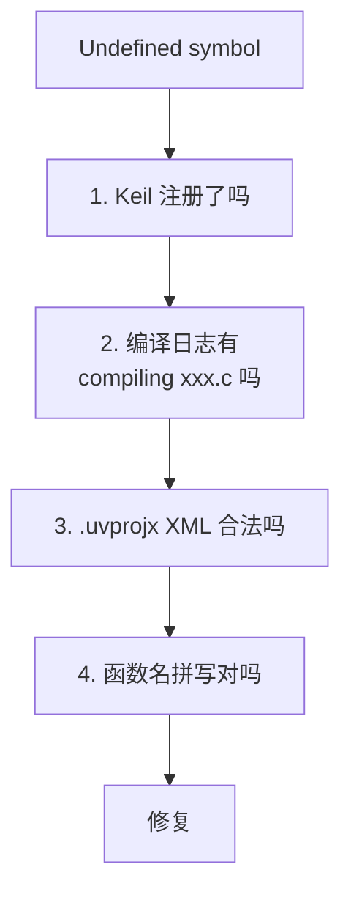

**验证 XML**：

```python
import xml.etree.ElementTree as ET
ET.parse('STM32F103ZET6_Project.uvprojx')   # 不报错 = 合法
```

**历史坑**：曾把新文件插进**库分组**，破坏了 XML 嵌套结构，
导致文件不参与编译。必须插在 `user/api` 分组下。

### 6.4 `argument of type "u32 *" is incompatible with "u16 *"`

```c
/* ❌ 错误 */
u32 rxLen = 0;
USART3_TakeFrame(s_rxBuf, &rxLen);

/* ✅ 正确 */
u16 rxLen = 0;
```

### 6.5 3 个 Warning：`integer operation result is out of range`

**来源**：`i2c.c`

```
warning: #61-D: integer operation result is out of range
PIOB->CRL &= ~(0x0f << 28);
```

**原因**：`0x0F << 28` 超出 int 范围。

**影响**：**无影响**，是标准库示例代码的遗留。

**想清零**：改成 `~(0x0FUL << 28)`

### 6.6 改了代码但编译没变化

**原因**：Keil 里打开着该文件，保存时用编辑器旧内容覆盖了磁盘新版本。

**处理**：Keil → **File → Reload**，再编译。

---

## 7 已修复的历史问题

**以下问题都已修复，改动时勿回退。**

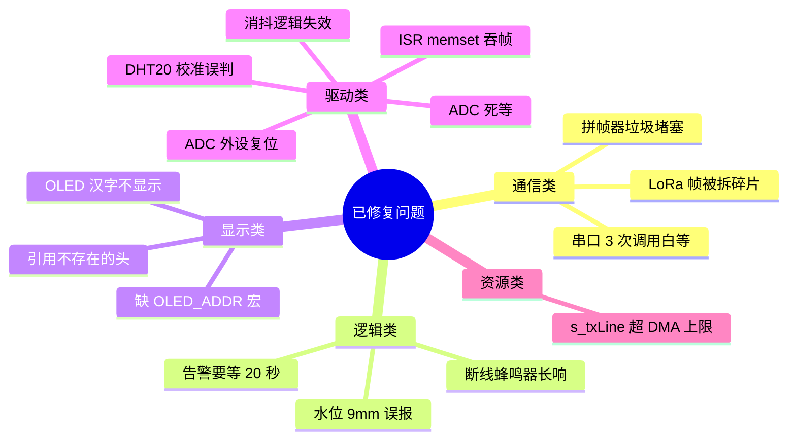

| 问题 | 位置 | 现象 | 根因 | 修复 |
|---|---|---|---|---|
| **LoRa 帧被拆碎片** | `frame_assembler.c` | 屏幕一直 `温度:--` | 模块按 32 字节分块吐数据，每次 IDLE 当一帧解析必然失败 | 新增流式拼帧器 |
| **拼帧器垃圾堵塞** | `frame_assembler.c` | 偶发卡死拼不出帧 | 缓冲残留垃圾等不到换行，堵死后续正常帧 | 缓冲内无 `$` 即清空 |
| **水位 9mm 误报** | `level.c`/`level.h` | 没水也报 9mm | 干燥噪声落进 10% 档，10%×90mm=9mm | 加 `LEVEL_IGNORE_BELOW_MM` 死区 |
| **告警要等 20 秒** | `main.c` | 超限后迟迟不显示 | 只标脏不立即刷屏 | 改边沿触发立即刷屏 |
| **断线蜂鸣器长响** | `main.c` | 断线后一直响 | `waterAlarm` 保持旧值 | 超时清告警 + 关蜂鸣器 |
| **串口 3 次调用白等 150ms** | `main.c` | 主循环卡顿 | 单一 DMA 缓冲连续调用互相等待 | 拼一次发出 |
| **`s_txLine` 超 DMA 上限** | `main.c` | 日志被静默截断 | 272 > 256 | 缩到 240 + 双重检查 |
| **OLED 汉字不显示** | `oled_font.h` | 方块/乱码 | `OLED_USE_FONT = 0` 字库未编译 | 改为 1 |
| **`oled.h` 引用不存在的头** | `oled.h` | 编译报错 | 移植残留 `#include "usart.h"` | 删除 |
| **缺 `OLED_ADDR` 等宏** | `i2c.h` | 编译报错 | 宏原本在丢失的 `usart.h` 里 | 补进 `i2c.h` |
| **ADC 外设复位** | `raindrop.c` | 转换永不完成 | 采样函数里做了 `RCC_APB2PeriphResetCmd(ADC1)` | 删除复位，只初始化一次 |
| **ISR memset 吞帧** | `usart1.c`/`usart3.c` | 偶发丢整帧 | 中断开头 memset 清掉整帧 | 改为消费者清空 |
| **缓冲区越界** | `usart1.c`/`usart3.c` | 内存被破坏 | 收满 256 字节后继续写 | 加边界判断 |
| **DHT20 校准误判** | `dht20.c` | 校准被永久跳过 | `0xFF & 0x18 == 0x18` 优先级问题 | 加括号 |
| **ADC 死等** | `raindrop.c` | 程序卡死 | `while(EOC==RESET);` 无超时 | 加超时计数 |
| **消抖逻辑失效** | `raindrop.c` | 3 次实际只比 1 次 | 一抖动就提前退出 | 走满次数 |
| **`strstr` 越界** | `lora_as32.c` | 偶发乱解析 | 对非 NUL 结尾缓冲做 strstr | 改带长度查找 |
| **Keil 工程文件名错** | `.uvprojx` | 编译不过 | 登记 `raindrop.c.c`，实际 `raindrop.c` | 修正 |
| **`SYSTEM_CORE_CLOCK` 未定义** | `raindrop.c` | 编译报错 | 宏不存在 | 改用 `SystemCoreClock` |

---

## 8 分段验证法

**改完代码后按顺序验证，任何一步不通问题就在那一步。**

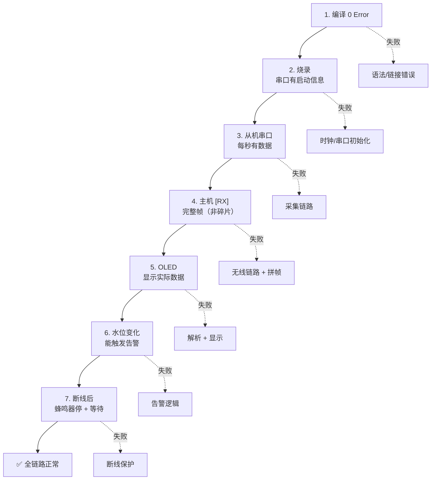

### 各步骤对应模块

| 步骤 | 涉及模块 | 失败说明 |
|---|---|---|
| 1 | 编译链 | 语法/链接错误 |
| 2 | `main.c` 初始化 | 时钟/串口/外设初始化问题 |
| 3 | `sensor_report.c` + 传感器驱动 | 采集链路问题 |
| 4 | `lora_as32.c` + `frame_assembler.c` | 无线链路 + 拼帧问题 |
| 5 | `master_app.c` + `oled.c` + `i2c.c` | 解析 + 显示问题 |
| 6 | `master_app.c` 告警判定 + `main.c` 告警调度 | 告警逻辑问题 |
| 7 | `main.c` 超时分支 | 断线保护问题 |

### 每步的判定依据

| 步骤 | 通过标准 |
|---|---|
| 1 | 日志末尾 `0 Error(s)` |
| 2 | 串口看到 `======== LoRa MASTER (RX + OLED) ========` |
| 3 | 每秒一行 `温度:xx℃,湿度:xx%,...` |
| 4 | `[RX]` 后是 71 字节完整帧，无 `[WARN]` |
| 5 | OLED 显示 `温度:26.5` 等实际值 |
| 6 | 水位 > 70% 时 1 秒内出现 `水位过高` |
| 7 | 断线 5 秒后显示 `等待从机`，蜂鸣器停 |

---

## 参考

- [系统设计](系统设计.md) — 架构与设计取舍
- [硬件规格](硬件规格.md) — 接线检查清单
- [通信协议](通信协议.md) — 帧格式与拼帧机制
- [参数配置](参数配置.md) — 参数与标定
- [开发环境](开发环境.md) — 编译与编码
