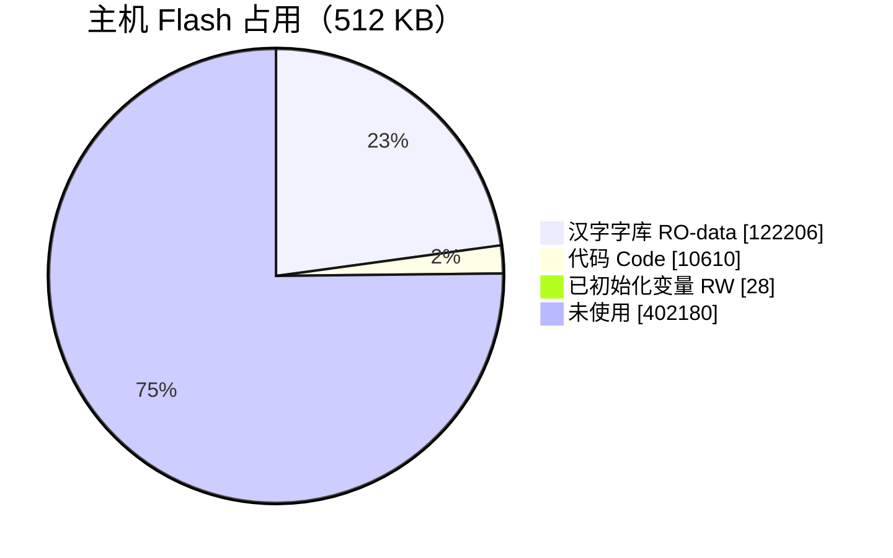
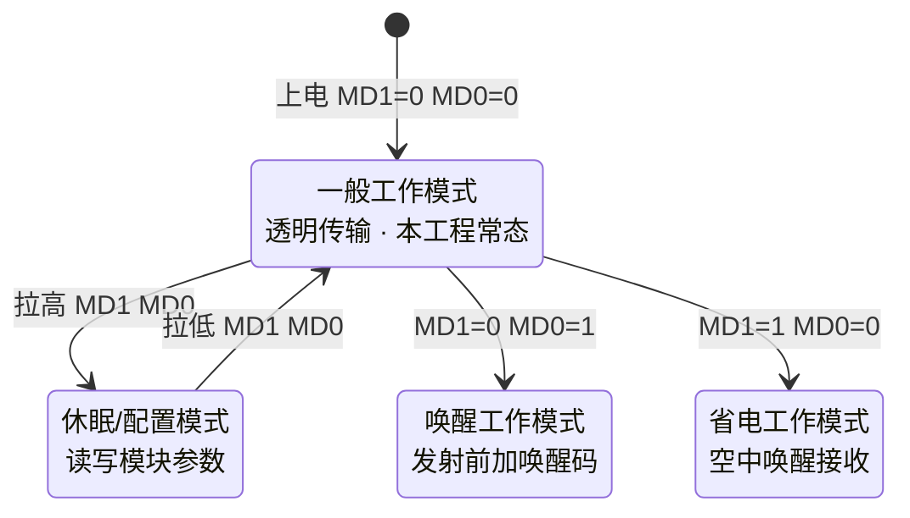
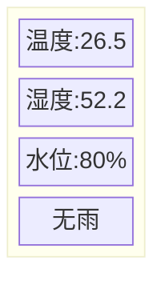
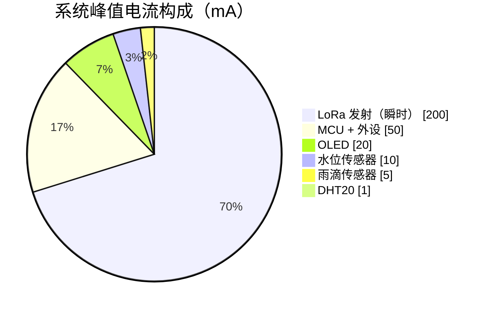
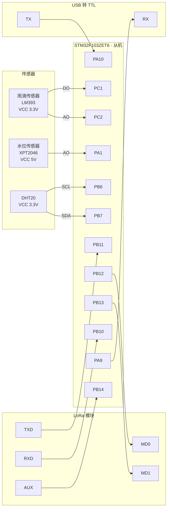
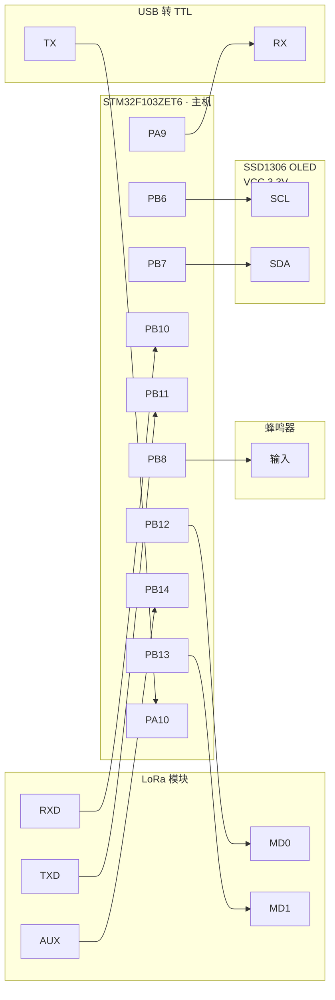
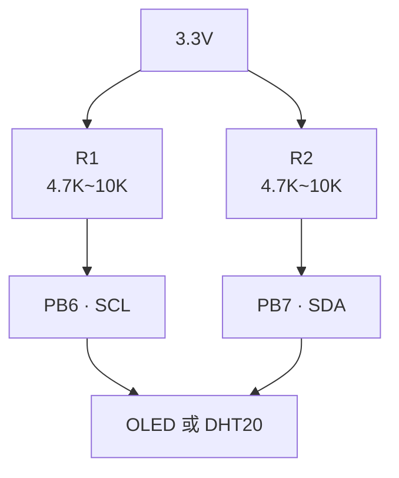

# 硬件规格

> 实际使用型号、引脚定义、电气参数与接线清单

---

## 目录

- [1 主控单元](#1-主控单元)
- [2 无线模块](#2-无线模块)
- [3 传感器](#3-传感器)
- [4 显示模块](#4-显示模块)
- [5 引脚分配](#5-引脚分配)
- [6 电气参数](#6-电气参数)
- [7 接线图](#7-接线图)
- [8 关键注意事项](#8-关键注意事项)

---

## 1 主控单元

### 1.1 型号与规格

| 项 | 规格 | 来源 |
|---|---|---|
| MCU 型号 | **STM32F103ZET6** | 工程 `<Device>STM32F103ZE</Device>` |
| 内核 | ARM Cortex-M3 | `<CPUTYPE("Cortex-M3")>` |
| 封装 | LQFP144 | — |
| Flash | **512 KB** | `IROM(0x08000000, 0x80000)` |
| RAM | **64 KB** | `IRAM(0x20000000, 0x10000)` |
| 外部晶振 | **12 MHz** | `CLOCK(12000000)` |
| 系统时钟 | 72 MHz | `system_stm32f10x.c` 配置 |
| 供电 | 3.3 V | 板载 LDO |
| 调试接口 | SWD | — |

### 1.2 Flash / RAM 占用

| 区域 | 从机 | 主机 |
|---|---|---|
| Code | 12078 B | 10610 B |
| RO-data | 498 B | **122206 B**（汉字字库） |
| RW-data | 56 B | 28 B |
| ZI-data | 2664 B | 4492 B |
| **Flash 合计** | ≈ 12.6 KB | ≈ 130 KB |
| **RAM 合计** | ≈ 2.7 KB | ≈ 4.4 KB |
| **Flash 占用率** | 2.5% | 25.4% |
| **RAM 占用率** | 4.2% | 6.9% |



> 主机 122 KB 的 `RO-data` 是 GB2312 一级汉字字库（3755 字，`oled_font.c`）。
> 512 KB Flash 完全够用。

### 1.3 栈配置

| 项 | 值 | 位置 |
|---|---|---|
| Stack_Size | **0x400（1 KB）** | `startup_stm32f10x_hd.s` |
| Heap_Size | 0（未使用） | 同上 |

> **栈只有 1KB**，所以所有大于 64 字节的缓冲区都放静态区（`.bss`），不放栈上。
> 详见 [系统设计 §5.6](系统设计.md#56-栈与缓冲区策略)。

---

## 2 无线模块

### 2.1 型号与规格

| 项 | 规格 | 来源 |
|---|---|---|
| 型号 | **AS32-TTL-100-C** | 上电读取版本号 |
| 版本字符串 | `AS32-TTL-100-C-V9.0` | `LORA_ReadVersion()` 实测 |
| 频段 | 470 MHz | 信道 0x3D = 471 MHz |
| 调制方式 | LoRa（CSS 线性调频扩频） | 模块规格 |
| 接口 | TTL 串口（UART） | — |
| 串口格式 | 9600 8N1（可配 115200） | `LORA_UART_BAUD_9600` |
| 空中速率 | 2.4 kbps（可配 9.6k / 19.2k） | `LORA_AIR_SPEED_2K4` |
| 传输模式 | 透明传输（可配定点） | `LORA_OPTION_TRANSPARENT` |
| 内部 FIFO | **256 字节** | 模块规格 |

### 2.2 引脚定义

| 模块引脚 | 方向 | 接到 MCU | 说明 |
|---|---|---|---|
| VCC | 电源 | 3.3V ~ 5V | 发射瞬时需 200mA |
| GND | 地 | GND | — |
| **TXD** | 模块输出 | **PB11**（USART3_RX） | 模块发 → MCU 收 |
| **RXD** | 模块输入 | **PB10**（USART3_TX） | 模块收 → MCU 发 |
| **MD0** | 输入 | **PB12** | 模式选择低位 |
| **MD1** | 输入 | **PB13** | 模式选择高位 |
| **AUX** | 输出 | **PB14** | 模块忙/闲指示 |

> **⚠️ TXD/RXD 极易接反**：模块 TXD 要接 MCU 的 RX，模块 RXD 要接 MCU 的 TX。
> 接反的现象是 `LORA CONFIG READ FAIL`。

### 2.3 工作模式（MD0 / MD1）

| MD1 | MD0 | 模式 | 代码常量 | 用途 |
|---|---|---|---|---|
| 0 | 0 | 一般工作 | `LORA_MODE_NORMAL` (0x00) | **透明传输（本工程）** |
| 0 | 1 | 唤醒工作 | `LORA_MODE_WAKE_UP` (0x01) | 发射前加唤醒码 |
| 1 | 0 | 省电工作 | `LORA_MODE_POWER_SAVE` (0x02) | 空中唤醒接收 |
| 1 | 1 | 休眠/配置 | `LORA_MODE_SLEEP` (0x03) | **读写参数（本工程）** |



> 程序启动拉低 MD0/MD1 进入一般模式；读写配置时临时切到休眠模式。

### 2.4 配置命令

| 命令 | 代码 | 功能 | 发送次数 |
|---|---|---|---|
| 设置参数 | `0xC0` | 写入模块参数（断电保存） | 1 次 |
| 读取参数 | `0xC1` | 读取当前配置 | **连续 3 次** |
| 读版本号 | `0xC3` | 读取硬件版本 | **连续 3 次** |
| 复位模块 | `0xC4` | 重启模块 | **连续 3 次** |
| 读电压 | `0xC5` | 读取模块实际电压 | **连续 3 次** |
| 恢复默认 | `0xC9` | 恢复出厂参数 | **连续 3 次** |

> **注意**：除 `0xC0` 外，其余命令都需**连续发送 3 次**才有效。

### 2.5 配置参数位定义

**`speed` 字节**（1 字节含 3 个字段）：

| 位 | 字段 | 说明 |
|---|---|---|
| bit7 ~ bit6 | 串口校验位 | `0x00` = 8N1 |
| bit5 ~ bit3 | 串口波特率 | `0x03` = 9600，`0x07` = 115200 |
| bit2 ~ bit0 | 空中速率 | `0x02` = 2.4k，`0x04` = 9.6k，`0x05` = 19.2k |

| 字段 | 值 | 代码常量 |
|---|---|---|
| 校验位 | `0x00` | `LORA_UART_8N1` |
| 波特率 | `0x03 << 3` | `LORA_UART_BAUD_9600` |
| 波特率 | `0x07 << 3` | `LORA_UART_BAUD_115200` |
| 空中速率 | `0x02` | `LORA_AIR_SPEED_2K4` |
| 空中速率 | `0x04` | `LORA_AIR_SPEED_9K6` |
| 空中速率 | `0x05` | `LORA_AIR_SPEED_19K2` |

**`option` 字节**：

| 值 | 代码常量 | 含义 |
|---|---|---|
| `0x40` | `LORA_OPTION_TRANSPARENT` | 透明传输 |
| `0xC0` | `LORA_OPTION_FIXED` | 定点传输 |

**`chan` 字节**：信道号，本工程 `0x3D`（471 MHz）。

> **型号差异**：AS32-TTL-100-**C** 出厂信道 `0x3D`（471MHz），
> AS32-TTL-100（无 C）出厂 `0x17`（433MHz），两者不通用。

### 2.6 本工程实际配置

| 字段 | 值 | 说明 |
|---|---|---|
| addh | `0x00` | 地址高字节 |
| addl | `0x00` | 地址低字节 |
| speed | `0x1A` | 8N1 + 9600 + 2.4k |
| chan | `0x3D` | 471 MHz |
| option | `0x40` | 透明传输 |

完整配置帧：`C0 00 00 1A 3D 40`

> **双端必须完全一致**，否则收不到。

---

## 3 传感器

### 3.1 雨滴传感器（从机）

| 项 | 规格 | 来源 |
|---|---|---|
| 型号 | LM393 比较器雨滴模块 | `raindrop.h` 注释 |
| 供电 | 3.3 V | — |
| 输出 1 | **DO**（数字量） | 干燥=高电平(1)，有雨=低电平(0) |
| 输出 2 | **AO**（模拟量） | 水越多电压越低 |
| AO 实测（干燥） | ADC **2895 ~ 3500** | 本工程实测 |
| 采样时间要求 | 长（高阻抗源） | 用 239.5 周期 |

**接线**：

| 模块 | STM32 | 说明 |
|---|---|---|
| VCC | 3.3V | |
| GND | GND | |
| DO | **PC1** | 上拉输入 |
| AO | **PC2** | 模拟输入，ADC1_IN12 |

**AO 电压与 ADC 换算**：

```
V(mV) = ADC × 3300 / 4095
湿润百分比 = (4095 - ADC) × 100 / 4095
```

### 3.2 水位传感器（从机）

| 项 | 规格 | 来源 |
|---|---|---|
| 型号 | **XPT2046 液位转换板** | `level.h` 注释 |
| 供电 | **5 V**（必须！） | `level.h` 注释 |
| AO 输出范围 | 0 ~ **1.0 V** 对应液位 0% ~ 100% | `level.h` 注释 |
| AO 最高电压 | 1.0 V（远低于 STM32 的 3.3V 上限） | 可直接接入，无需分压 |
| 输出特性 | 与液位**非线性** | 需门限表换算 |
| 实测空水 ADC | ≈ **20** | 本工程实测 |
| 实测满水 ADC | ≈ **716**（显示 80%） | 本工程实测 |

**接线**：

| 模块 | STM32 | 说明 |
|---|---|---|
| VCC | **5V** | ⚠️ 不是 3.3V |
| GND | GND | |
| AO | **PA1** | 模拟输入，ADC1_IN1 |
| DO | **不接** | 本工程只用 AO |

> **为什么不用 DO**：参考例程把 DO 接 PA4，但 PA4 是 DAC_OUT1 / WIFI复位 / 蓝牙EN，
> 属于无线模块接口区，容易和 LoRa 模块干涉。本工程只用 AO，靠 ADC 换算判定水位。

> **⚠️ PA1 必须拔 P10 跳线帽**：PA1 在开发板上兼作 TPAD 触摸检测脚，
> 不拔跳线帽会被 TPAD 电路干扰，读数不准。

### 3.3 DHT20 温湿度（从机）

| 项 | 规格 | 来源 |
|---|---|---|
| 型号 | **DHT20** | `dht20.h` |
| 接口 | 软件模拟 I2C | — |
| 器件地址 | **0x38**（写 0x70 / 读 0x71） | `DHT20_ADDR` |
| 供电 | 3.3 V | — |
| 上拉电阻 | **必须 4.7K~10K** | 开漏 I2C |
| 触发命令 | `0xAC 0x33 0x00` | `DHT20_CMD_TRIGGER` |
| 测量耗时 | **80 ms** | `DHT20_MEASURE_MS` |
| 上电稳定 | 100 ms | `DHT20_STARTUP_MS` |
| 轮询间隔 | 5 ms × 20 次 | `DHT20_POLL_GAP_MS` × `DHT20_POLL_TIMES` |
| 最小周期 | 2000 ms | `DHT20_CYCLE_MS` |

**接线**：

| 模块 | STM32 | 说明 |
|---|---|---|
| VCC | 3.3V | |
| GND | GND | |
| SCL | **PB6** | 需 4.7K~10K 上拉到 3.3V |
| SDA | **PB7** | 需 4.7K~10K 上拉到 3.3V |

**状态位定义**：

| 位 | 值 | 含义 |
|---|---|---|
| BUSY | `0x80` | 测量中 |
| CAL | `0x18` | 已校准（bit3 + bit4 同时置位） |

**错误码**：

| 码 | 常量 | 含义 |
|---|---|---|
| 0 | `DHT20_OK` | 成功 |
| 1 | `DHT20_ERR_TRIG` | 触发命令无应答 |
| 2 | `DHT20_ERR_STATUS` | 测量超时 |
| 3 | `DHT20_ERR_READ` | 读数据无应答 |
| 4 | `DHT20_ERR_CRC` | CRC 校验失败 |

> **DHT20 与板载 AT24C02 共用 PB6/PB7**：AT24C02 地址 0x50，DHT20 地址 0x38，不冲突。
> 本工程只在主循环顺序访问，不并发，安全。

---

## 4 显示模块

### 4.1 SSD1306 OLED（主机）

| 项 | 规格 | 来源 |
|---|---|---|
| 型号 | **SSD1306** 0.96 寸 | `oled.h` 注释 |
| 分辨率 | **128 × 64** | `OLED_WIDTH` / `OLED_HEIGHT` |
| 接口 | 4 针 I2C | `oled.h` 注释 |
| I2C 地址 | **0x3C**（7 位） | `OLED_ADDR` |
| 模块标称地址 | 0x78（8 位写法，`0x78 >> 1 = 0x3C`） | — |
| 页数 | 8 页（64 / 8） | `OLED_PAGE_COUNT` |
| 显存大小 | 1024 字节（128 × 8） | `OLED_GRAM_SIZE` |
| 上拉电阻 | **必须 4.7K~10K** | 开漏 I2C |
| 字库 | GB2312 一级汉字 **3755 字** | `OLED_CN_COUNT` |
| 字模格式 | 汉字 16×16（32 字节），ASCII 8×16（16 字节） | `oled_font.c` |

**接线**：

| 模块 | STM32 | 说明 |
|---|---|---|
| VCC | 3.3V | |
| GND | GND | |
| SCL | **PB6** | 需 4.7K~10K 上拉到 3.3V |
| SDA | **PB7** | 需 4.7K~10K 上拉到 3.3V |

### 4.2 显示布局

屏幕分 4 行，每行占 2 页（16 px 高）：

| 行 | page | 内容 |
|---|---|---|
| 1 | 0 | `温度:26.5` |
| 2 | 2 | `湿度:52.2` |
| 3 | 4 | `水位:80%`（告警时 `水位:75%!`） |
| 4 | 6 | `无雨/小雨/中雨/大雨`（告警时 `水位过高`） |



> 每行 16 px 高（2 页），4 行共 64 px，占满屏幕高度。

### 4.3 字库说明

`oled_font.c` 是 **856 KB 源码**，编译后占 **122 KB Flash**。

| 项 | 值 |
|---|---|
| ASCII 字符 | 0x20 ~ 0x7F，共 96 个，每个 16 字节 |
| 汉字 | GB2312 一级汉字 3755 个，每个 32 字节 |
| 汉字索引 | `idx = (高字节 - 0xB0) × 94 + (低字节 - 0xA1)` |
| 覆盖范围 | 仅 GB2312 一级汉字（常用字），二级汉字和符号不支持 |

> **字库开关**：`oled_font.h` 的 `OLED_USE_FONT` 必须是 **1**，
> 否则字库不参与编译，汉字显示不出来（`RO-data` 会从 122206 降到 498）。

---

## 5 引脚分配

### 5.1 从机（感知节点）

| 功能 | 引脚 | 外设/模式 | 备注 |
|---|---|---|---|
| 雨滴 DO | **PC1** | 上拉输入 | 1=无水，0=有水 |
| 雨滴 AO | **PC2** | 模拟输入 | ADC1_IN12 |
| 水位 AO | **PA1** | 模拟输入 | ADC1_IN1，**拔 P10 跳线帽** |
| DHT20 SCL | **PB6** | 开漏输出 | 软件 I2C，4.7K~10K 上拉 |
| DHT20 SDA | **PB7** | 开漏/浮空 | 软件 I2C，4.7K~10K 上拉 |
| LoRa TXD→ | PB11 | USART3_RX | 模块 TXD 接 MCU RX |
| LoRa RXD← | PB10 | USART3_TX | 模块 RXD 接 MCU TX |
| LoRa MD0 | PB12 | 开漏输出 | 模式选择低位 |
| LoRa MD1 | PB13 | 开漏输出 | 模式选择高位 |
| LoRa AUX | PB14 | 浮空输入 | 模块忙/闲状态 |
| 调试串口 TX | PA9 | 复用推挽 | USART1_TX |
| 调试串口 RX | PA10 | 浮空输入 | USART1_RX |
| LED0 | PB5 | 推挽输出 | 低电平点亮 |
| LED1 | PE5 | 推挽输出 | 低电平点亮 |
| 蜂鸣器 | PB8 | 推挽输出 | 从机未使用 |

### 5.2 主机（汇聚节点）

| 功能 | 引脚 | 外设/模式 | 备注 |
|---|---|---|---|
| OLED SCL | **PB6** | 开漏输出 | 软件 I2C，4.7K~10K 上拉 |
| OLED SDA | **PB7** | 开漏/浮空 | 软件 I2C，4.7K~10K 上拉 |
| LoRa TXD→ | PB11 | USART3_RX | 模块 TXD 接 MCU RX |
| LoRa RXD← | PB10 | USART3_TX | 模块 RXD 接 MCU TX |
| LoRa MD0 | PB12 | 开漏输出 | |
| LoRa MD1 | PB13 | 开漏输出 | |
| LoRa AUX | PB14 | 浮空输入 | |
| 调试串口 TX | PA9 | 复用推挽 | USART1_TX |
| 调试串口 RX | PA10 | 浮空输入 | USART1_RX |
| LED0 | PB5 | 推挽输出 | 低电平点亮 |
| LED1 | PE5 | 推挽输出 | 低电平点亮 |
| **蜂鸣器** | **PB8** | 推挽输出 | 水位超限告警 |

> **PB6/PB7 在两台板子上接不同外设**：从机接 DHT20，主机接 OLED。
> 两台板子物理独立，不冲突。

### 5.3 ADC 通道映射

STM32F103 的 ADC 通道与引脚是**固定映射**，不能任意指定：

| ADC 通道 | 对应引脚 | 本工程用途 |
|---|---|---|
| ADC_IN0 ~ IN7 | PA0 ~ PA7 | **PA1 = IN1（水位）** |
| ADC_IN8 ~ IN9 | PB0 ~ PB1 | — |
| ADC_IN10 ~ IN15 | PC0 ~ PC5 | **PC2 = IN12（雨滴）** |
| ADC3_IN4 ~ IN8 | PF6 ~ PF10 | — |

> **PE 口（PE0~PE15）没有任何 ADC 通道**，所以 AO 不能接 PE 引脚。
> 早期版本用 PC0（IN10）实测恒为 4095（悬空），已改用 PC2。

### 5.4 系统资源占用

| 资源 | 用途 |
|---|---|
| SysTick | `delay.c` 软件延时（未用中断） |
| USART1 IRQ | 调试串口接收（IDLE 中断） |
| USART3 IRQ | LoRa 串口接收（IDLE 中断） |
| DMA1_Channel4 | USART1 发送（从机/主机都用） |
| ADC1 | 雨滴 IN12 + 水位 IN1（共用，分时切换） |

---

## 6 电气参数

### 6.1 供电需求

| 设备 | 电压 | 电流 | 备注 |
|---|---|---|---|
| STM32F103ZET6 | 3.3 V | ~50 mA | 板载 LDO |
| AS32-TTL-100-C（待机） | 3.3~5 V | ~10 mA | |
| AS32-TTL-100-C（发射） | 3.3~5 V | **~200 mA（瞬时）** | ⚠️ 供电要足 |
| 雨滴传感器 | 3.3 V | ~5 mA | |
| XPT2046 水位 | **5 V** | ~10 mA | ⚠️ 必须 5V |
| DHT20 | 3.3 V | ~1 mA | |
| SSD1306 OLED | 3.3 V | ~20 mA | |



> **LoRa 发射瞬时 200mA** 是供电设计的关键约束。
> 用 USB 供电且线材细时，发射瞬间可能电压跌落导致丢包，
> 建议用短粗线或独立 5V 电源。

### 6.2 电平匹配

| 信号 | 发送方电平 | 接收方容忍 | 是否需要电平转换 |
|---|---|---|---|
| LoRa TXD → MCU RX | 3.3 V | 3.3 V | 否 |
| MCU TX → LoRa RXD | 3.3 V | 3.3 V | 否 |
| 雨滴 AO → PC2 | 0~3.3 V | 0~3.3 V | 否 |
| 水位 AO → PA1 | 0~1.0 V | 0~3.3 V | 否 |
| OLED / DHT20 I2C | 3.3 V 开漏 | 3.3 V | 否（需上拉） |

> 所有信号都在 3.3V 域内，**无需电平转换**。
> 水位传感器虽然 5V 供电，但 AO 最高只输出 1.0V，不会损坏 MCU。

### 6.3 上拉电阻要求

| 总线 | 上拉 | 原因 |
|---|---|---|
| PB6/PB7（I2C） | **4.7K~10K 到 3.3V** | 开漏输出必须上拉才能输出高电平 |
| PB14（AUX） | 浮空输入（模块内部处理） | — |
| PC1（雨滴 DO） | MCU 内部上拉 | 配置为 `GPIO_Mode_IPU` |

> **I2C 没上拉 = 通信全失败**。这是最常见的接线错误之一。

---

## 7 接线图

### 7.1 从机（感知节点）



### 7.2 主机（汇聚节点）



### 7.3 上拉电阻连接



> I2C 是开漏总线，**必须靠外部上拉电阻把电平拉到高**。
> 没有上拉时 SCL/SDA 一直是低电平，通信完全失败。

---

## 8 关键注意事项

### 8.1 ⚠️ 水位传感器必须拔 P10 跳线帽

**PA1 在开发板上兼作 TPAD 触摸检测脚。**

| 状态 | 结果 |
|---|---|
| 不拔 P10 | PA1 被 TPAD 电路干扰 → 水位读数乱跳 / 不准 |
| **拔掉 P10** | PA1 独立，读数正常 |

这是**最常见**的接线问题。

### 8.2 ⚠️ 水位传感器必须 5V 供电

| 供电 | 满水 ADC | 显示 |
|---|---|---|
| 3.3 V | ~400 | 60%（幅度不足） |
| **5 V** | ~716 | 80%（正常） |

> AO 最高只输出 1.0V，远低于 STM32 的 3.3V 输入上限，**5V 供电不会烧 MCU**。

### 8.3 ⚠️ I2C 必须加上拉电阻

DHT20（从机）和 OLED（主机）都走 PB6/PB7 软件 I2C。

**开漏输出必须有上拉才能输出高电平**，否则总线一直是低电平，通信全失败。

| 情况 | 处理 |
|---|---|
| 模块自带 4.7K 上拉 | 可直接用 |
| 模块无上拉 | **必须在 SCL/SDA 各接 4.7K~10K 到 3.3V** |

**快速验证**：万用表测 PB6/PB7 对地电压，静态应接近 3.3V。

### 8.4 ⚠️ LoRa 模块 TXD/RXD 不要接反

| 模块引脚 | 接到 MCU |
|---|---|
| TXD | **PB11**（MCU 的 RX） |
| RXD | **PB10**（MCU 的 TX） |

接反 → `LORA CONFIG READ FAIL`

### 8.5 ⚠️ P5 跳线帽必须选到无线模块

开发板的 P5 跳线帽决定串口/无线模块的选择。
**必须选到无线模块**，否则 USART3 连不到 LoRa 模块。

### 8.6 两机 LoRa 参数必须完全一致

| 参数 | 值 |
|---|---|
| 地址 | 0x0000 |
| 信道 | 0x3D（471MHz） |
| 串口 | 9600 8N1 |
| 空中速率 | 2.4 kbps |
| 模式 | 透明传输 |

任何一项不一致 → 收不到数据。

### 8.7 两机距离不要太近

LoRa 信号过强时（< 1m）接收可能反而失败。
**建议测试时拉开 2~3 米。**

---

## 参考

- STM32F103ZET6 数据手册（引脚定义、电气特性）
- STM32F103x8/B/C/D/E 参考手册 RM0008（ADC 通道映射、USART）
- AS32-TTL-100-C 模块使用手册（引脚、模式表、配置命令）
- XPT2046 液位转换板说明
- DHT20 数据手册（地址 0x38、时序、状态位）
- SSD1306 数据手册（I2C 地址、初始化序列、显存组织）
