# 系统设计

> 系统架构、LoRa 组网、软件分层与关键设计取舍

---

## 目录

- [1 项目概述](#1-项目概述)
- [2 系统架构](#2-系统架构)
- [3 LoRa 通信链路](#3-lora-通信链路)
- [4 关键设计：LoRa 分段吐数据与流式拼帧](#4-关键设计lora-分段吐数据与流式拼帧)
- [5 软件设计](#5-软件设计)
- [6 栈与缓冲区策略](#6-栈与缓冲区策略)
- [7 数据流与时序](#7-数据流与时序)
- [8 设计取舍汇总](#8-设计取舍汇总)
- [9 已知限制](#9-已知限制)

---

## 1 项目概述

### 1.1 应用背景

土壤墒情监测需要在野外测点布设感知节点，采集雨情、水位、温湿度等环境参数，并汇聚到集中点显示与告警。

这类场景的典型约束：

| 约束 | 说明 |
|---|---|
| **距离** | 测点与观察点相距数十米以上，拉线不现实 |
| **无公网** | 野外无 WiFi、无光纤，4G 信号可能不稳定 |
| **多点** | 未来可能需要多个测点（当前为单点验证） |
| **低复杂度** | 课程/毕设级别，需要可维护、可调试 |

### 1.2 为什么选 LoRa

| 方案 | 距离 | 功耗 | 穿墙 | 结论 |
|---|---|---|---|---|
| WiFi（ESP8266） | ~50 m | 高（峰值 200mA+） | 差 | 距离不够，且需 AP |
| 蓝牙 | ~10 m | 低 | 差 | 距离太短 |
| **LoRa 470MHz** | **数百米 ~ 公里级** | **低（发射 ~100mA 瞬时）** | **较好** | **选用** |

LoRa 的核心优势是**接收灵敏度高**（可达 -148 dBm），在低速率下能用很小功率实现远距离通信。

### 1.3 双机角色划分

| | 从机（Slave / 感知节点） | 主机（Master / 汇聚节点） |
|---|---|---|
| **角色** | 发送端 | 接收端 |
| **职责** | 采集传感器 → 组帧 → LoRa 发送 | LoRa 接收 → 拼帧 → 解析 → 显示 + 告警 |
| **传感器** | 雨滴 + 水位 + DHT20 | 无 |
| **显示** | 本地串口（调试） | SSD1306 OLED 128×64 |
| **告警** | 无 | 蜂鸣器（水位 > 70%） |
| **上报周期** | 1 秒 | — |
| **屏幕刷新** | — | 10 秒（告警例外，立即） |

> 两台板子硬件相同（都是 STM32F103ZET6 开发板），只是**烧录的固件不同**。

---

## 2 系统架构

### 2.1 分层架构

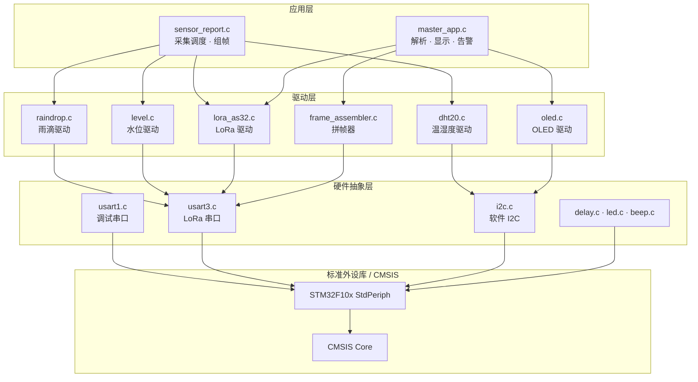

### 2.2 硬件连接关系

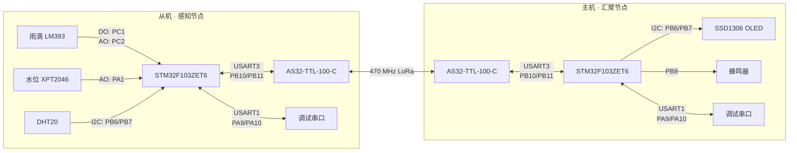

### 2.3 引脚占用对比

| 功能 | 从机 | 主机 |
|---|---|---|
| PC1 | 雨滴 DO | 空闲 |
| PC2 | 雨滴 AO（ADC1_IN12） | 空闲 |
| PA1 | 水位 AO（ADC1_IN1） | 空闲 |
| PB6 | DHT20 SCL（软件 I2C） | **OLED SCL**（软件 I2C） |
| PB7 | DHT20 SDA（软件 I2C） | **OLED SDA**（软件 I2C） |
| PB8 | 蜂鸣器（未用） | **蜂鸣器（告警用）** |
| PB10/PB11 | LoRa TX/RX（USART3） | LoRa TX/RX（USART3） |
| PB12/PB13/PB14 | LoRa MD0/MD1/AUX | LoRa MD0/MD1/AUX |
| PA9/PA10 | 调试串口（USART1） | 调试串口（USART1） |
| PB5/PE5 | LED0/LED1 | LED0/LED1 |

> **PB6/PB7 在两台板子上接不同外设** —— 从机接 DHT20，主机接 OLED。
> 因为两台板子物理独立，不冲突。

---

## 3 LoRa 通信链路

### 3.1 链路参数

| 参数 | 值 | 来源 |
|---|---|---|
| 模块 | AS32-TTL-100-C | — |
| 地址 | `0x0000` | `main.c` 配置 |
| 信道 | `0x3D`（471MHz） | `lora_as32.h` → `LORA_DEFAULT_CHAN` |
| 串口波特率 | 9600 8N1 | `main.c` → `LORA_BRR` |
| 空中速率 | 2.4 kbps | `LORA_AIR_SPEED_2K4` |
| 传输模式 | 透明传输 | `LORA_OPTION_TRANSPARENT` (0x40) |

**配置写入流程**（两机相同）：

```c
config.addh   = 0x00;
config.addl   = 0x00;
config.speed  = LORA_UART_8N1 | LORA_UART_BAUD_9600 | LORA_AIR_SPEED_2K4;
config.chan   = LORA_DEFAULT_CHAN;
config.option = LORA_OPTION_TRANSPARENT;
LORA_SetConfig(&config);
```

### 3.2 配置时序

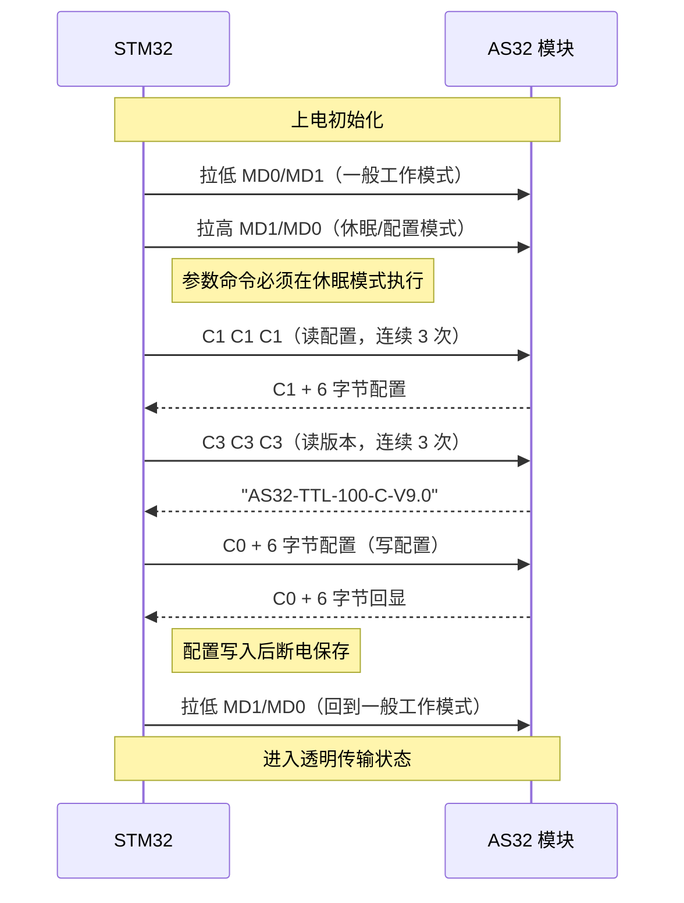

### 3.3 发送耗时估算

从机单次上报的耗时构成（用于判断 1 秒周期是否可行）：

| 环节 | 耗时 | 依据 |
|---|---|---|
| 雨滴 AO 采样（10 次 + 5 次自检） | ~1 ms | 每次采样 50µs 间隔 |
| 水位采样（10 次 + 5 次自检） | ~2 ms | ADC 转换 + 200µs 间隔 |
| DHT20 单次测量 | ~100 ms | 含 80ms 测量等待 |
| LoRa 发送 71 字节 @9600 | ~74 ms | 71 × 10bit / 9600 |
| **合计** | **~200~250 ms** | |

```mermaid
gantt
    title 从机单次上报耗时构成
    dateFormat X
    axisFormat %L ms

    section 采集
    雨滴采样           :a1, 0, 1
    水位采样           :a2, after a1, 2
    DHT20 测量         :a3, after a2, 100

    section 通信
    LoRa 发送 71B      :a4, after a3, 74

    section 余量
    周期剩余           :a5, after a4, 823
```

> **结论**：1 秒周期余量约 750ms，安全。**不要低于 500ms**，否则 DHT20 来不及。

### 3.4 为什么不加应答重传

| 方案 | 代价 | 收益 |
|---|---|---|
| 加 ACK + 重传 | 主机需回发，从机需开接收窗 → 功耗上升；协议复杂度翻倍 | 可靠性提升 |
| **不加（当前）** | 丢帧就丢一帧，1 秒后自然补上 | **简单，功耗低** |

理由：**数据是周期性重复采集的**，丢一帧的损失是 1 秒的数据空白，而下一帧马上就到。
相比"保证每帧都到"的复杂度，**用周期性冗余换取简单性**更划算。

坏帧由校验和丢弃，不会污染显示。

---

## 4 关键设计：LoRa 分段吐数据与流式拼帧

**这是本项目最重要、最容易踩的坑。**

### 4.1 问题现象

主机屏幕一直显示 `温度:--`，但串口明明收到了数据。

### 4.2 实测日志

主机串口打印（同一毫秒级连续到达）：

```
[RX] $RAIN,DHT20,T=26.5,H=52.2,A        ← 32 字节
DC=4092,V=3297,WET=0,DO=1,LEVEL         ← 32 字节
[RX] =0,WL=80*8B                         ← 7 字节
```

完整一帧应该是 71 字节：

```
$RAIN,DHT20,T=26.5,H=52.2,ADC=4092,V=3297,WET=0,DO=1,LEVEL=0,WL=80*8B
```

### 4.3 根因

**AS32-TTL-100-C 模块通过空口收到一包数据后，不是一次性吐到串口，而是按 32 字节一块分块输出。**

块与块之间串口会短暂空闲（≥1 字符时间），触发 STM32 的 **IDLE 中断**。

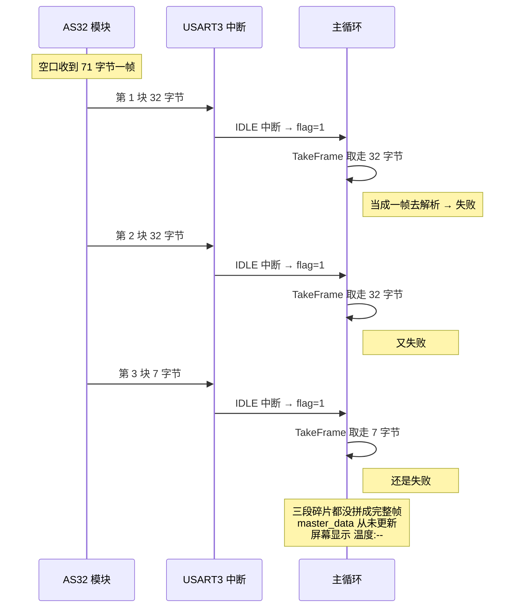

原代码逻辑：

```c
if (USART3_TakeFrame(buf, &len)) {     // 每次 IDLE 都取走
    Master_ParseFrame(buf, len);        // 拿到的是 32 字节碎片
}
```

碎片里找不到完整帧头 + 校验和 → `Master_ParseFrame()` 必然返回 0
→ `master_data` 从未被填充 → 屏幕显示 `温度:--`。

### 4.4 解决方案：流式拼帧器

`code/master/user/api/frame_assembler.c`

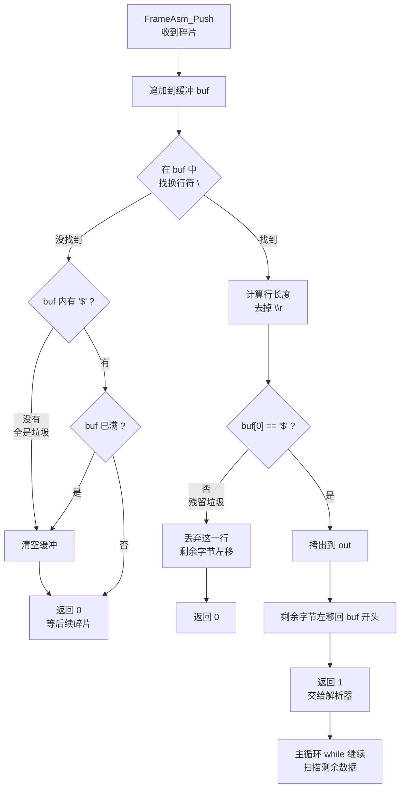

主循环用法：

```c
while (FrameAsm_Push(&s_frameAsm, s_rxBuf, rxLen,
                     s_frameBuf, sizeof(s_frameBuf), &frameLen))
{
    if (Master_ParseFrame(s_frameBuf, frameLen)) {
        showingWait = 0;
        screenDirty = 1;
    }
    rxLen = 0;   // 后续数据已在缓冲里，继续扫
}
```

### 4.5 三个关键防护

| 防护 | 作用 | 不做的后果 |
|---|---|---|
| **行首必须是 `$`** | 挡住 `=0,WL=80*8E` 这种半截残留 | 残帧和新帧粘连，解析全失败 |
| **缓冲内无 `$` 即清空** | 垃圾流等不到换行会堵死缓冲 | 后续正常帧永远拼不出来（**实测踩到过**） |
| **缓冲满即清空** | 防止 `len` 越界 | 数组溢出破坏相邻内存 |

### 4.6 验证

用真实碎片流做的端到端测试：

| 测试 | 结果 |
|---|---|
| 真实 32+32+7 碎片拼帧 | ✅ 拼出完整 71 字节帧 |
| 一次喂入完整帧 | ✅ |
| 垃圾前置（`=0,WL=80*8E`） | ✅ 垃圾被丢弃，后续正常 |
| 逐字节到达（79 次） | ✅ |
| 垃圾洪水 640 字节后恢复 | ✅ 无 `$` 即清空生效 |
| 半帧 + 补全 | ✅ |
| 连续 10 帧 | ✅ 10/10 全解析正确 |

---

## 5 软件设计

### 5.1 从机主流程

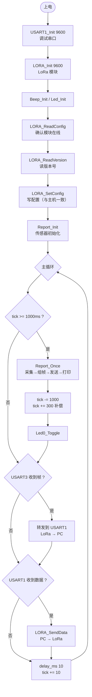

**周期计时修正**（`main.c` 的 `[FIX-DBG4]`）：

```c
tick -= REPORT_INTERVAL_MS;      // 保留溢出余量
Report_Once();
tick += REPORT_COST_ESTIMATE_MS; // 补偿上报阻塞的 ~300ms
```

### 5.2 主机主流程

```mermaid
flowchart TD
    START([上电]) --> INIT1["USART1_Init 9600"]
    INIT1 --> INIT2["LORA_Init 9600"]
    INIT2 --> INIT3["Beep_Init / Led_Init"]
    INIT3 --> CFG["LORA 读配置 / 读版本 / 写配置"]
    CFG --> ASM["FrameAsm_Reset<br/>清拼帧缓冲"]
    ASM --> OLED["Master_Init<br/>OLED 初始化 + 等待画面"]

    OLED --> LOOP{"主循环"}

    LOOP --> RX{"USART3 收到数据 ?"}
    RX -->|"是"| RX1["while FrameAsm_Push<br/>流式拼帧"]
    RX1 --> RX2{"Master_ParseFrame<br/>成功 ?"}
    RX2 -->|"是"| RX3["showingWait=0<br/>screenDirty=1<br/>Led0_Toggle"]
    RX2 -->|"否"| RX4["打印 WARN<br/>丢弃"]
    RX -->|"否"| PC

    RX3 --> PC
    RX4 --> PC

    PC{"USART1 收到数据 ?"} -->|"是"| PC1["LORA_SendData<br/>PC → LoRa"]
    PC -->|"否"| IDLE
    PC1 --> IDLE

    IDLE["idleMs += 10"] --> TIMEOUT{"idleMs >= 5000 ?"}
    TIMEOUT -->|"是"| TO1["显示等待画面<br/>清告警 + 关蜂鸣器<br/>showingWait=1"]
    TIMEOUT -->|"否"| SCR
    TO1 --> SCR

    SCR["screenMs += 10"] --> EDGE{"告警状态<br/>发生跳变 ?"}
    EDGE -->|"是"| E1["立即蜂鸣器<br/>立即刷屏"]
    EDGE -->|"否"| PERIOD
    E1 --> PERIOD

    PERIOD{"screenMs >= 10000<br/>且 dirty ?"} -->|"是"| P1["Master_Display<br/>screenMs=0 dirty=0"]
    PERIOD -->|"否"| BEEP
    P1 --> BEEP

    BEEP{"告警中 ?"} -->|"是"| B1{"beepMs >= 500 ?"}
    B1 -->|"是"| B2["蜂鸣器翻转"]
    B1 -->|"否"| TICK
    B2 --> TICK
    BEEP -->|"否"| TICK

    TICK["delay_ms 10"] --> LOOP
```

### 5.3 数据与显示解耦

**核心思想**：数据更新和屏幕刷新是两个独立的事。

| | 更新频率 | 触发者 |
|---|---|---|
| **数据**（`master_data`） | 每秒（每收到一帧） | `Master_ParseFrame()` |
| **屏幕**（OLED） | 每 10 秒 | `Master_Display()` |

```c
/* 收帧：只更新数据，不碰屏幕 */
if (Master_ParseFrame(s_rxBuf, rxLen)) {
    screenDirty = 1;          // 标记"有新数据待显示"
}

/* 10 秒定时：才真正渲染 */
if (screenMs >= SCREEN_REFRESH_MS && screenDirty && !showingWait) {
    screenMs = 0;
    screenDirty = 0;
    Master_Display();         // 渲染当前最新数据
}
```

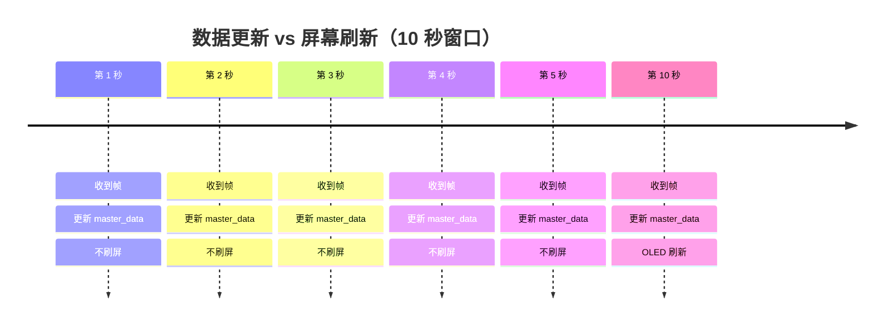

**好处**：数据始终最新，屏幕不闪。

### 5.4 告警为什么是例外

告警不能等 10 秒 —— 水位超限要立刻知道。

用**边沿触发**（检测状态跳变）：

```c
if (master_data.waterAlarm != prevAlarm)     // 状态变了
{
    prevAlarm = master_data.waterAlarm;

    if (master_data.waterAlarm) {
        beepOn = 1;
        Beep_Ctrl(1);                        // 立即响，不等 500ms 计时
    } else {
        beepOn = 0;
        Beep_Ctrl(0);                        // 立即停
    }

    if (!showingWait) {
        screenMs = 0;
        Master_Display();                    // 立即刷屏
    }
}
```

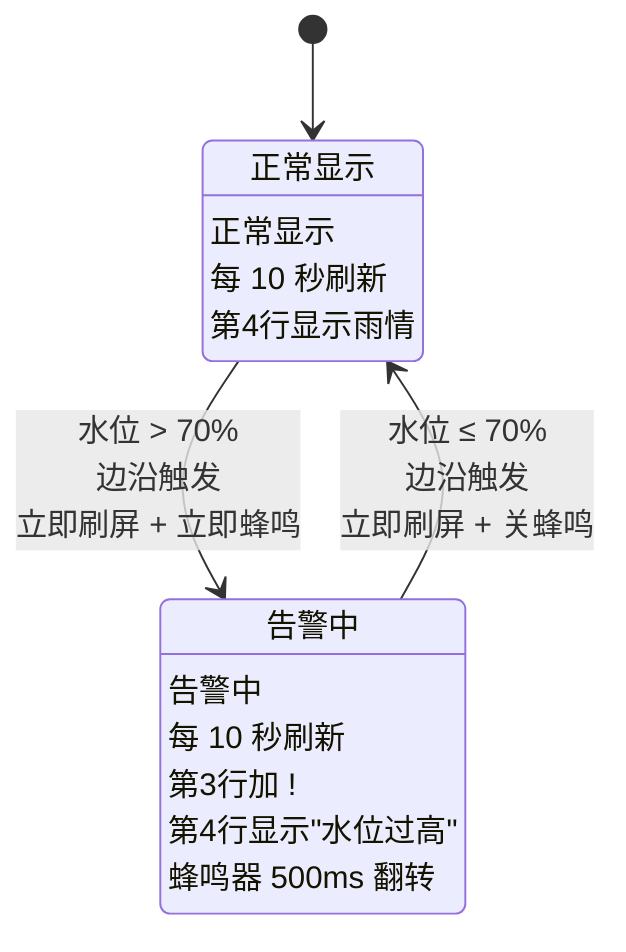

**为什么用边沿而不是电平**：

| 触发方式 | 行为 | 问题 |
|---|---|---|
| 电平触发 | 告警期间每轮循环都刷屏 | OLED 疯狂闪烁 |
| **边沿触发（当前）** | 只在跳变瞬间刷一次 | 告警持续期间屏幕稳定 |

### 5.5 断线保护

5 秒没收到数据 → 显示"等待从机" + **必须清告警**：

```c
master_data.waterAlarm = 0;
prevAlarm = 0;
beepOn = 0;
beepMs = 0;
Beep_Ctrl(0);
```

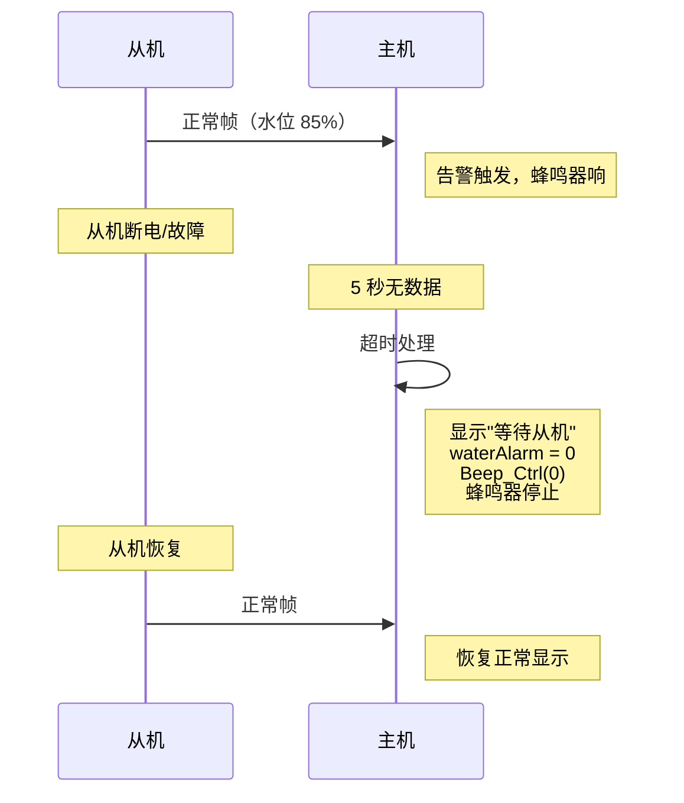

> **不清理的后果**：如果断线前正在告警，`waterAlarm` 会保持 1，蜂鸣器**无限期长响**。
> 这是实测发现的 bug。

---

## 6 栈与缓冲区策略

### 6.1 栈只有 1KB

`startup_stm32f10x_hd.s` 中：

```asm
Stack_Size      EQU     0x00000400      ; 1 KB
```

### 6.2 缓冲区分配原则

| 缓冲区 | 大小 | 位置 | 原因 |
|---|---|---|---|
| `s_rxBuf` | 256 B | `.bss` 静态 | 接收缓冲，不放栈 |
| `s_frameAsm` | 258 B | `.bss` 静态 | 拼帧器（含 256B buf） |
| `s_frameBuf` | 256 B | `.bss` 静态 | 拼出的完整帧 |
| `s_txLine` | 240 B | `.bss` 静态 | 串口发送拼接缓冲 |
| `s_line` | 24 B | `.bss` 静态 | OLED 单行文本 |

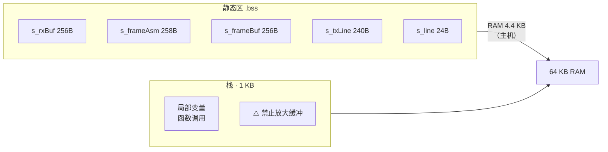

### 6.3 为什么不能放栈上

DHT20 读一次要经过：

```
DHT20_Read
 └─ DHT20_Read_Raw
     └─ 多个 I2C 时序函数
         └─ GPIO 操作
```

调用层级较深，若再在 `main()` 栈帧里放 256 字节缓冲，叠加起来余量紧张，**有栈溢出踩坏变量的风险**。

> 静态区代价仅几百字节 RAM，主机总 RAM 占用 4.4 KB / 64 KB，非常宽裕。

---

## 7 数据流与时序

### 7.1 正常时序（水位正常）

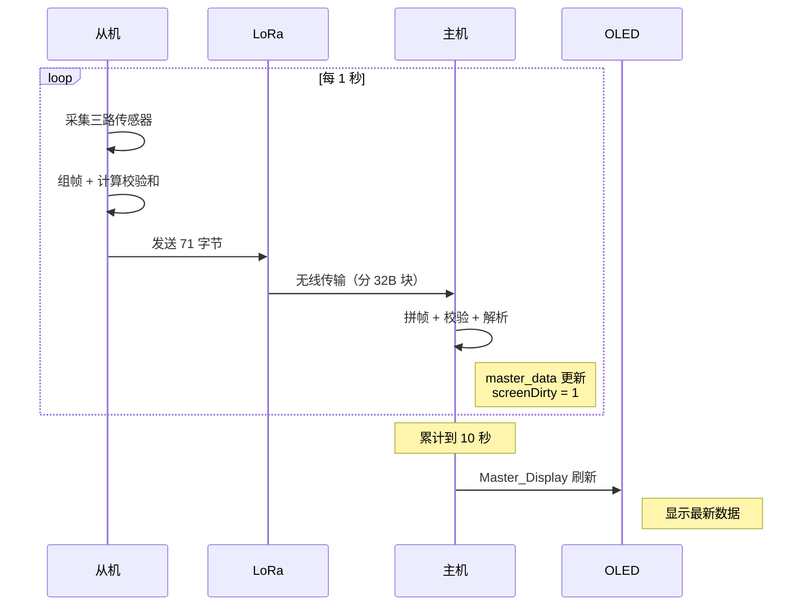

### 7.2 告警时序

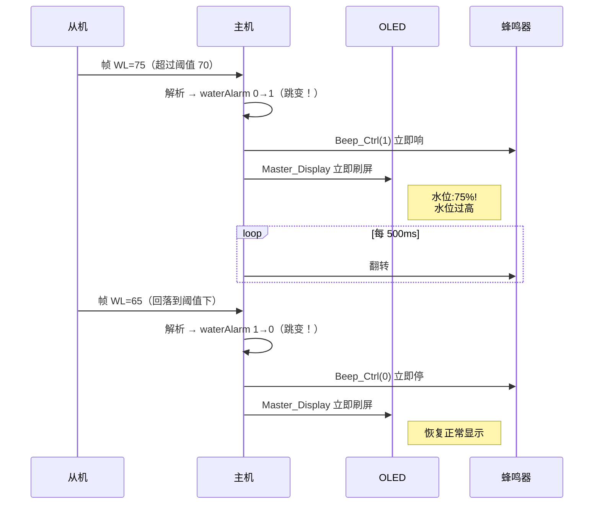

**告警响应延迟 < 1 秒**（取决于串口收帧速度），远小于 10 秒刷新周期。

### 7.3 断线时序

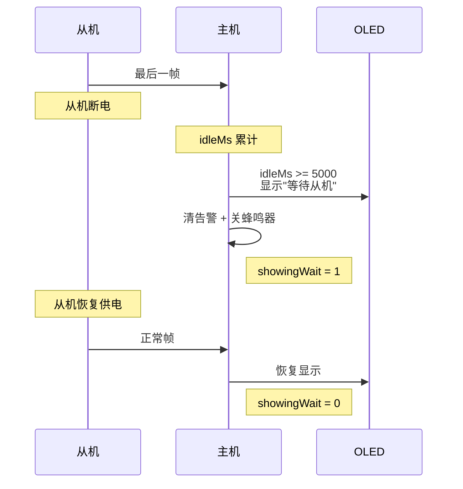

---

## 8 设计取舍汇总

| 决策点 | 选择 | 放弃的方案 | 理由 |
|---|---|---|---|
| **通信** | LoRa 470MHz 私有链路 | WiFi / 蓝牙 | 距离够、功耗低、无需公网 |
| **协议** | ASCII 文本帧 | 二进制 TLV | 对端串口助手可直接读，调试成本低；帧长 71 字节对 LoRa 不是瓶颈 |
| **可靠性** | 校验和丢弃坏帧，靠周期冗余 | ACK + 重传 | 数据周期重复，丢一帧损失 1 秒；重传要开接收窗，功耗和复杂度都上升 |
| **帧同步** | 按 `\r\n` 流式拼帧 | 定长帧 / 长度前缀 | LoRa 模块分块吐数据，只能按行边界重组 |
| **显示** | 数据与显示解耦（10 秒） | 每帧都刷屏 | OLED 频繁刷新会闪烁 |
| **告警** | 边沿触发立即刷屏 | 电平触发 / 等周期 | 告警要快；边沿触发避免持续闪烁 |
| **水位** | 非线性门限表 + 噪声死区 | 线性换算 | 传感器输出与液位非线性；死区消除干燥噪声误报 |
| **ADC** | 寄存器直操 | 标准库封装 | 标准库路径下 EXTTRIG/SWSTART 时序不明确，实测转换不启动 |
| **缓冲** | 静态区（.bss） | 栈上 | 栈只有 1KB，DHT20 调用层级深，栈上放 256B 缓冲有溢出风险 |
| **字库** | 内置 GB2312 一级汉字 | 外部字库芯片 | 120KB Flash 可承受，减少外部器件 |
| **I2C** | 软件模拟 | 硬件 I2C | 引脚灵活，时序可控，避免硬件 I2C 的 STM32 已知问题 |

---

## 9 已知限制

| 限制 | 说明 | 影响 |
|---|---|---|
| **点对点组网** | 当前为 1 主 1 从 | 扩展多从机需改协议加地址字段 |
| **单向数据流** | 从机→主机单向；主机可发但固件未用于控制从机 | 无法远程配置从机 |
| **无应答重传** | 透明传输，丢帧不重传 | 偶发 1 秒数据空白 |
| **无时间戳** | 帧内不含时间 | 主机无法判断数据新鲜度（靠 5 秒超时兜底） |
| **水位量程固定 90mm** | 门限表按 90mm 标定 | 换传感器需重新标定门限表 |
| **单信道** | 所有节点同一信道 | 多从机需分时或分信道 |
| **无低功耗设计** | 从机 1 秒一帧，全程运行 | 需市电或大容量电池，不适合长期电池供电 |
| **主机保留从机代码** | `sensor_report.c` 等在主机工程中但未使用 | 仅占 Flash，不影响功能 |
| **水位满水显示 80%** | 门限表按旧量程标定，实测满水 ADC 716 而门限表要 1100 | 需按实测 ADC 重新标定门限表 |

---

## 参考

- STM32F103x8/B/C/D/E 参考手册 **RM0008**（ADC、USART、DMA、GPIO 章节）
- STM32F103ZET6 数据手册
- AS32-TTL-100-C 模块使用手册（信道、空中速率、配置命令、分块行为）
- XPT2046 液位转换板说明
- DHT20 数据手册
- SSD1306 OLED 驱动 IC 手册
