# 通信协议

> 帧格式、字段语义、校验算法与拼帧机制

---

## 目录

- [1 协议选型](#1-协议选型)
- [2 物理层](#2-物理层)
- [3 帧格式](#3-帧格式)
- [4 字段详解](#4-字段详解)
- [5 校验和算法](#5-校验和算法)
- [6 流式拼帧机制](#6-流式拼帧机制)
- [7 解析器实现](#7-解析器实现)
- [8 异常帧处理](#8-异常帧处理)
- [9 实测样例](#9-实测样例)

---

## 1 协议选型

### 1.1 为什么用 ASCII 文本帧

| 方案 | 优点 | 缺点 | 结论 |
|---|---|---|---|
| **ASCII 文本帧** | 串口助手直接可读，调试零成本；字段自描述 | 体积略大（71 vs ~20 字节） | **选用** |
| 二进制 TLV | 紧凑 | 需要解析工具才能看，调试困难 | 放弃 |
| Modbus RTU | 标准化 | 为寄存器读写设计，不适合周期性上报 | 放弃 |
| LoRaWAN | 标准化 | 需网关和网络服务器，重 | 放弃 |

**关键权衡**：帧长 71 字节对 LoRa（单帧上限 256 字节）完全不是瓶颈，
而**调试成本**才是真实痛点 —— 用文本帧，现场用串口助手就能看清每个字段。

### 1.2 帧结构总览

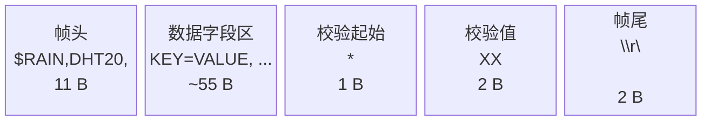

| 部分 | 长度 | 说明 |
|---|---|---|
| 帧头 | 11 B | `$RAIN,DHT20,` 固定字符串 |
| 数据字段区 | ~55 B | `KEY=VALUE` 形式，逗号分隔 |
| 校验和 | 3 B | `*` + 两位大写 HEX |
| 帧尾 | 2 B | `\r\n` |
| **合计** | **71~79 B** | 随数值位数变化 |

---

## 2 物理层

| 参数 | 值 | 说明 |
|---|---|---|
| 模块 | AS32-TTL-100-C | |
| 频段 | 470 MHz | 信道 0x3D = 471 MHz |
| 调制 | LoRa（CSS 线性调频扩频） | |
| 空中速率 | 2.4 kbps | `LORA_AIR_SPEED_2K4` |
| 串口波特率 | 9600 8N1 | |
| 传输模式 | 透明传输 | `OPTION = 0x40` |
| 地址 | 0x0000 | 透明模式下不使用 |
| 单帧上限 | 256 B（模块 FIFO） | 本协议 71~79 B，安全 |

### 2.1 发送耗时

71 字节 @ 9600 8N1：

```
每字节 = 1 起始位 + 8 数据位 + 1 停止位 = 10 bit
71 × 10 / 9600 = 73.96 ms ≈ 74 ms
```

```mermaid
gantt
    title 71 字节 @ 9600 8N1 传输时间
    dateFormat X
    axisFormat %L ms
    section 串口传输
    起始位+数据位+停止位 (71×10bit) :0, 74
```

### 2.2 分块行为

**关键特性**：AS32 模块收到空口数据后，**不是一次性吐到串口**，而是按 **32 字节一块**分块输出。

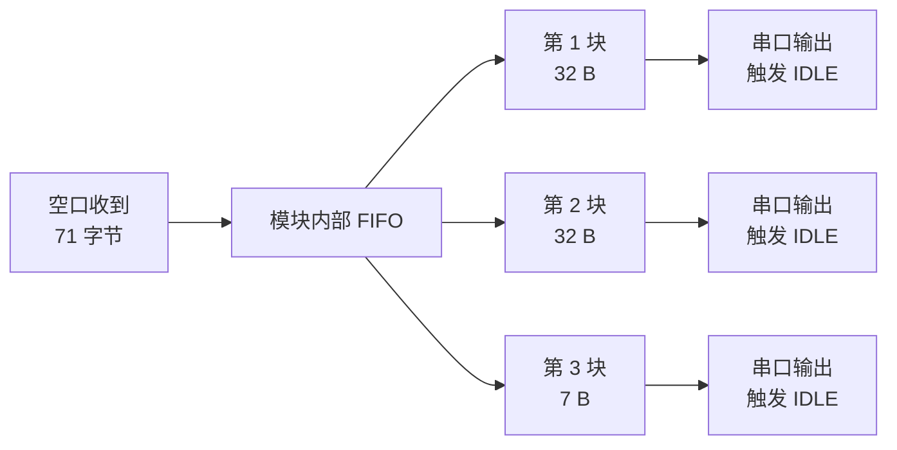

> 这是**主机必须做拼帧**的根本原因。详见 [§6](#6-流式拼帧机制)。

---

## 3 帧格式

### 3.1 完整格式

```
$RAIN,DHT20,T=<温度>,H=<湿度>,ADC=<雨滴ADC>,V=<雨滴电压>,WET=<湿润度>,DO=<数字量>,LEVEL=<雨情>,WL=<水位>*<校验和>\r\n
```

### 3.2 示例

**正常帧（无雨，水位 80%）**：

```
$RAIN,DHT20,T=26.5,H=52.2,ADC=4092,V=3297,WET=0,DO=1,LEVEL=0,WL=80*8B
```

**DHT20 失败**（温湿度为 `--`）：

```
$RAIN,DHT20,T=--,H=--,ADC=3000,V=2418,WET=27,DO=1,LEVEL=0,WL=0*9C
```

**大雨 + 高水位**：

```
$RAIN,DHT20,T=27.0,H=88.8,ADC=900,V=725,WET=78,DO=0,LEVEL=3,WL=95*XX
```

### 3.3 字段顺序

**顺序固定**，但解析器不依赖顺序（按 `KEY=` 查找），因此**增删字段向后兼容**。

> 主机的解析器用 `FindSub()` 按 key 定位，所以从机即使调整字段顺序或增加新字段，
> 只要主机不认识就自动忽略，不会解析失败。

---

## 4 字段详解

| 字段 | 类型 | 范围 | 含义 | 无效值 |
|---|---|---|---|---|
| `T=` | 定点小数 | -50.0 ~ 100.0 | 温度 ℃，一位小数 | `--` |
| `H=` | 定点小数 | 0.0 ~ 100.0 | 湿度 %RH，一位小数 | `--` |
| `ADC=` | 无符号整数 | 0 ~ 4095 | 雨滴 AO 原始 ADC 值 | — |
| `V=` | 无符号整数 | 0 ~ 3300 | 雨滴 AO 电压 mV | — |
| `WET=` | 无符号整数 | 0 ~ 100 | 雨滴湿润百分比 | — |
| `DO=` | 单字符 | `0` / `1` | 雨滴数字量 1=无水 0=有水 | — |
| `LEVEL=` | 单字符 | `0` ~ `3` | 雨情等级 | — |
| `WL=` | 无符号整数 | 0 ~ 100 | **水位百分比** | — |

### 4.1 温湿度（`T=` / `H=`）

**格式**：`整数部分.一位小数`，如 `26.5`、`-5.3`、`0.0`

**无效标记**：`--`（两个连字符）

> **解析要点**：`-` 既可能是负号，也可能是无效标记的前缀。
> 解析器必须先检查 `-` 后面是否还是 `-`，是则判无效，否则当负号。
> 见 [§7.2](#72-定点小数解析-parsefixed1)。

**来源**：DHT20 读取失败时输出 `--`。

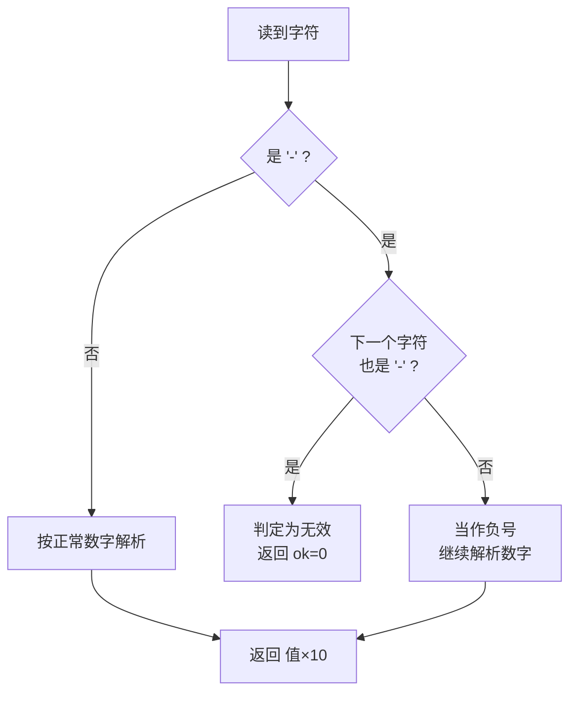

### 4.2 雨滴 ADC / 电压 / 湿润度

| 字段 | 计算方式 |
|---|---|
| `ADC=` | 10 次采样均值（`RAIN_FILTER_TIMES = 10`） |
| `V=` | `ADC × 3300 / 4095`（mV） |
| `WET=` | `(4095 - ADC) × 100 / 4095`（湿润百分比） |

**雨情判定**（按 `ADC`）：

| ADC 范围 | LEVEL | 雨情 |
|---|---|---|
| > 2500 | 0 | 无雨 |
| 2500 ~ 2000 | 1 | 小雨 |
| 2000 ~ 1500 | 2 | 中雨 |
| ≤ 1500 | 3 | 大雨 |

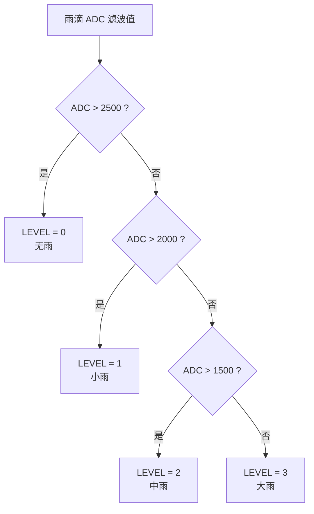

### 4.3 水位（`WL=`）

**范围**：0 ~ 100（百分比）

**来源链路**：

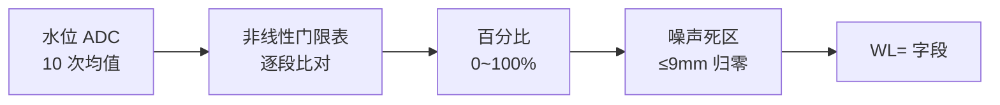

| ADC 门限 | 百分比 | 高度 |
|---|---|---|
| ≥ 1100 | 100% | 90mm |
| ≥ 900 | 90% | 81mm |
| ≥ 600 | 80% | 72mm |
| ≥ 440 | 70% | 63mm |
| ≥ 340 | 60% | 54mm |
| ≥ 300 | 50% | 45mm |
| ≥ 250 | 40% | 36mm |
| ≥ 220 | 30% | 27mm |
| ≥ 190 | 20% | 18mm |
| ≥ 160 | 10% | 9mm |
| < 160 | 0% | 0mm |

**噪声死区**：`高度 ≤ LEVEL_IGNORE_BELOW_MM(9mm)` 时强制归零。

> 即 ADC 160~189 这一档（原 10% = 9mm）会被判为 0%。
> **原因**：传感器干燥时 ADC 在 160~189 抖动，落进 10% 档，
> 而 `10% × 90mm = 9mm`，导致"没水也报 9mm"。

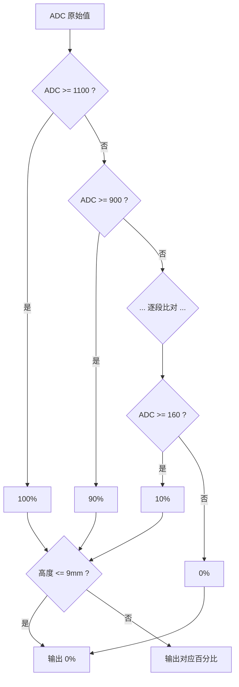

---

## 5 校验和算法

### 5.1 算法定义

**对 `*` 之前的所有字节做累加，取低 8 位，写成两位大写十六进制 ASCII。**

```
校验和 = (Σ frame[0..starIdx-1]) & 0xFF
```

### 5.2 计算流程

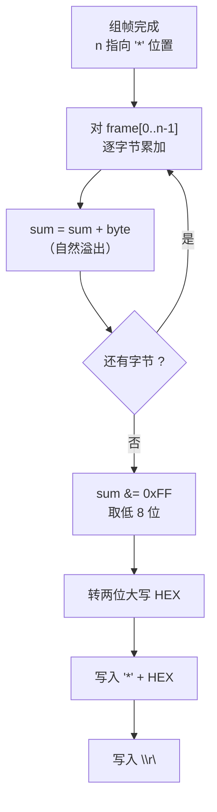

### 5.3 从机计算（发送侧）

```c
static uint8_t Report_Checksum(const uint8_t *p, uint16_t len)
{
    uint8_t sum = 0;
    uint16_t i;
    for (i = 0; i < len; i++) {
        sum += p[i];
    }
    return sum;
}

/* 组帧时 */
bodyLen = n;                              // 此时 n 指向 '*' 应放的位置
sum = Report_Checksum(pFrame, bodyLen);   // 对已写入的字节求和
pFrame[n++] = '*';
Report_Hex2(sum, &pFrame[n]);             // 写两位大写 HEX
n += 2;
pFrame[n++] = '\r';
pFrame[n++] = '\n';
```

### 5.4 主机验证（接收侧）

```c
/* 1. 找 '*' */
for (i = headIdx; i < len; i++) {
    if (frame[i] == '*') { starIdx = i; break; }
}
if (starIdx < 0) return 0;              // 没有校验和

/* 2. '*' 后必须还有 2 个 HEX 字符 */
if ((uint16_t)(starIdx + 3) > len) return 0;

/* 3. 解析两位 HEX */
h1 = HexVal(frame[starIdx + 1]);
h2 = HexVal(frame[starIdx + 2]);
if (h1 < 0 || h2 < 0) return 0;

/* 4. 比对 */
sumCalc = CheckSum(frame, (uint16_t)starIdx);
sumRecv = (uint8_t)(((uint8_t)h1 << 4) | (uint8_t)h2);
if (sumCalc != sumRecv) return 0;       // 校验失败，丢弃
```

### 5.5 校验和样例

对 `$RAIN,DHT20,T=26.5,H=52.2,ADC=4092,V=3297,WET=0,DO=1,LEVEL=0,WL=80` 求和：

```
字节和 & 0xFF = 0x8B
```

所以帧尾是 `*8B`。

### 5.6 为什么用累加和而不是 CRC

| 方案 | 检错能力 | 代码量 | 结论 |
|---|---|---|---|
| **累加和** | 能检出单字节错误、多数多字节错误 | ~5 行 | **选用** |
| CRC-16 | 强得多 | ~40 行 + 查表 | 放弃 |

**理由**：LoRa 物理层本身有 FEC 和前向纠错，误码率已经很低。
累加和足够检出偶发错误，而 CRC 的额外保护在当前场景下收益有限。

> 累加和的已知弱点：**不检测字节顺序错乱**（交换两个字节和不变）。
> 但 LoRa 不会乱序，所以可接受。

---

## 6 流式拼帧机制

### 6.1 为什么需要拼帧

**AS32-TTL-100-C 模块通过空口收到一包数据后，不是一次性吐到串口，而是按 32 字节一块分块输出。**

块与块之间串口空闲 ≥1 字符时间，触发 STM32 的 **IDLE 中断**。

**实测**：71 字节的一帧被拆成 3 段：

```
[RX] $RAIN,DHT20,T=26.5,H=52.2,A        ← 32 字节
DC=4092,V=3297,WET=0,DO=1,LEVEL         ← 32 字节
[RX] =0,WL=80*8B                         ← 7 字节
```

如果每次 IDLE 收到的数据就当一帧解析，**必然失败**。

### 6.2 拼帧算法

`code/master/user/api/frame_assembler.c`

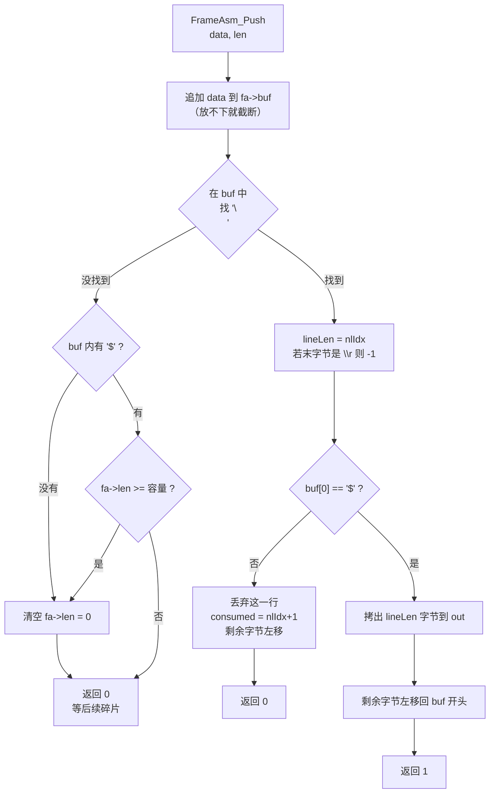

### 6.3 三个关键防护

| 防护 | 代码 | 不做会怎样 |
|---|---|---|
| **行首必须是 `$`** | `if (fa->buf[0] != FRAME_START_CHAR)` | 半截残留（如 `=0,WL=80*8E`）会和新帧粘连，解析全失败 |
| **无 `$` 即清空** | 扫描 buf 找 `$`，找不到就 `fa->len = 0` | 垃圾流永远等不到换行，**堵死缓冲**，后续正常帧拼不出来（实测踩到） |
| **满即清空** | `if (fa->len >= FRAME_ASM_BUF_SIZE) fa->len = 0;` | `len` 越界，破坏相邻内存 |

### 6.4 调用方式

```c
while (FrameAsm_Push(&s_frameAsm, s_rxBuf, rxLen,
                     s_frameBuf, sizeof(s_frameBuf), &frameLen))
{
    /* 拼出一帧完整数据 */
    if (Master_ParseFrame(s_frameBuf, frameLen)) {
        showingWait = 0;
        screenDirty = 1;
    }
    rxLen = 0;   // 后续数据已在缓冲里，传 0 继续扫描
}
```

**为什么用 `while` 而不是 `if`**：
一次喂入的数据里可能包含多帧（比如两帧粘连到达），
`while` 能一次把缓冲里所有完整帧都取出来。

**为什么 `rxLen = 0`**：
第一次调用把 `s_rxBuf` 的数据追加进缓冲；
后续调用传 `len=0`，只是让拼帧器继续扫描缓冲里剩下的数据，不重复追加。

### 6.5 拼帧时序

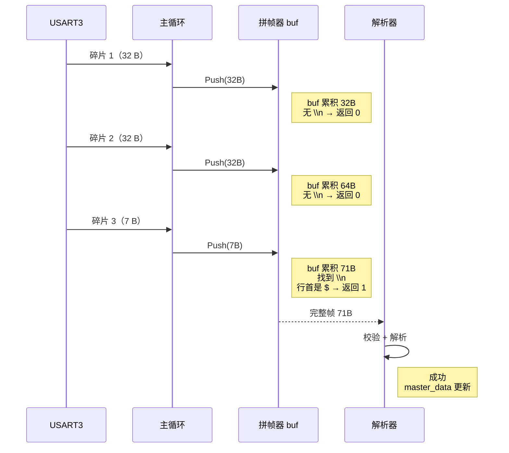

### 6.6 缓冲容量

| 项 | 值 | 说明 |
|---|---|---|
| `FRAME_ASM_BUF_SIZE` | **256** B | 可容纳约 3 帧（71B/帧） |
| 正常帧长 | 71~79 B | |
| 最坏情况 | 256 B | 正好装满 |

---

## 7 解析器实现

### 7.1 字段定位

不用 `strstr`（帧不是 NUL 结尾，会越界读），自己实现带长度边界的查找：

```c
static int32_t FindSub(const uint8_t *buf, uint16_t len,
                       const char *pat, uint16_t patLen)
{
    uint16_t i;
    if (len < patLen) return -1;

    for (i = 0; i + patLen <= len; i++) {
        uint16_t j;
        for (j = 0; j < patLen; j++) {
            if (buf[i + j] != (uint8_t)pat[j]) break;
        }
        if (j == patLen) return (int32_t)i;
    }
    return -1;
}
```

**为什么不用 `strstr`**：拼帧器输出的帧虽然加了 NUL，但为了安全，
所有查找都限定在 `[0, bodyLen)` 内，绝不依赖 NUL 结尾。

### 7.2 定点小数解析 ParseFixed1

```c
/* 解析 "26.5" -> 265（乘 10 后的整数）*/
/* 解析 "-5.3" -> -53 */
/* 解析 "--"   -> *ok = 0（无效）*/

static int32_t ParseFixed1(const uint8_t *buf, uint16_t len,
                           uint16_t pos, uint8_t *ok)
{
    int32_t sign = 1, intPart = 0, frac = 0;
    uint8_t digits = 0;

    *ok = 0;
    if (pos >= len) return 0;

    if (buf[pos] == '-') {
        if ((pos + 1 < len) && (buf[pos + 1] == '-')) {
            return 0;              // "--" 是无效标记，不是负数
        }
        sign = -1;
        pos++;
    }

    while (pos < len && buf[pos] >= '0' && buf[pos] <= '9') {
        intPart = intPart * 10 + (buf[pos] - '0');
        pos++; digits++;
    }
    if (digits == 0) return 0;

    if (pos < len && buf[pos] == '.') {
        pos++;
        if (pos < len && buf[pos] >= '0' && buf[pos] <= '9') {
            frac = buf[pos] - '0';
            pos++;
        }
    }

    *ok = 1;
    return sign * (intPart * 10 + frac);
}
```

> **关键**：`--` 必须先于负号判断，否则 `--` 会被解析成"负的 0"，
> 显示成 `温度:0.0` 而不是 `温度:--`。

### 7.3 解析流程

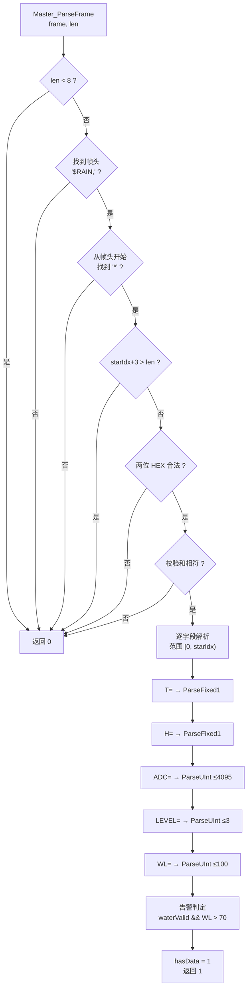

### 7.4 范围检查

所有数值字段都做**上限检查**，防止异常数据：

```c
if (ok && (v <= 4095u)) master_data.rainAdc = (uint16_t)v;   // ADC
if (ok && (v <= 3u))    master_data.rainLevel = (uint8_t)v;  // LEVEL
if (ok && (v <= 100u))  { master_data.waterLevel = (uint8_t)v; waterValid = 1; }
```

> 超出范围的值**不更新**对应字段（保持上次值），并置无效标志。

---

## 8 异常帧处理

| 异常 | 检测点 | 处理 |
|---|---|---|
| **帧太短** | `len < 8` | 丢弃 |
| **帧头不匹配** | 找不到 `$RAIN,` | 丢弃 |
| **没有校验和** | 找不到 `*` | 丢弃 |
| **校验和不完整** | `starIdx + 3 > len` | 丢弃 |
| **校验和字符非法** | `HexVal < 0` | 丢弃 |
| **校验和不符** | `sumCalc != sumRecv` | 丢弃，打印 `[WARN]` |
| **数值超范围** | `v > 上限` | 不更新字段，置无效 |
| **字段缺失** | `FindSub` 返回 -1 | 对应字段置无效（显示 `--`） |
| **老固件无 `WL=`** | `FindSub` 返回 -1 | `waterValid = 0`，水位显示 `--` |

### 8.1 异常处理流程

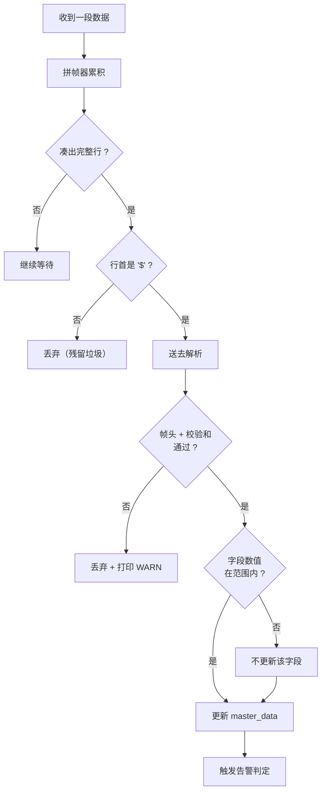

### 8.2 向后兼容

主机解析器按 `KEY=` 查找，**不依赖字段顺序和数量**：

| 从机变化 | 主机行为 |
|---|---|
| 新增字段 | 不认识就忽略，不影响 |
| 删字段 | 找不到就显示 `--` |
| 调整顺序 | 照常解析 |

> **注意**：`WL=` 字段是主机显示水位的唯一来源。
> 如果从机是**老固件**（没有 `WL=`），主机会显示 `水位:--`，需重新烧录从机。

---

## 9 实测样例

### 9.1 从机串口输出（每秒一行）

```
温度:26.4℃,湿度:49.6%,无雨,水位:80%(ADC=716)
温度:26.4℃,湿度:49.6%,无雨,水位:80%(ADC=709)
温度:26.4℃,湿度:49.7%,无雨,水位:80%(ADC=676)
温度:26.4℃,湿度:49.6%,无雨,水位:80%(ADC=689)
```

> 括号里的 `(ADC=xxx)` 是水位原始 ADC，用于现场校准门限表。

### 9.2 主机串口输出（`[RX]` 后是拼好的完整帧）

```
[RX] $RAIN,DHT20,T=26.5,H=52.2,ADC=4092,V=3297,WET=0,DO=1,LEVEL=0,WL=80*8B
```

> 如果看到的是 32 字节碎片而不是完整帧，说明拼帧器没生效
> （检查 `frame_assembler.c` 是否注册进 Keil 工程）。

### 9.3 主机串口告警

```
[WARN] frame parse/checksum failed, ignored
```

出现这条说明：**帧头对但校验失败**，可能原因：

1. 串口误码（偶发，可忽略）
2. 从机与主机的校验和算法不一致（检查代码版本）
3. 帧被截断（拼帧缓冲太小）

### 9.4 帧长实测

| 场景 | 帧长 |
|---|---|
| 温湿度正常、ADC 4 位、WL 2 位 | 71 B |
| 温湿度 `--` | 71 B |
| ADC 4 位、WL 3 位（100） | 72 B |
| 最长（负温度 + 满字段） | ~79 B |

---

## 参考

- AS32-TTL-100-C 模块手册（FIFO 大小、分块行为）
- STM32F103 参考手册 RM0008 §27（USART IDLE 中断）
- `code/slave/user/api/sensor_report.c`（帧组装）
- `code/master/user/api/frame_assembler.c`（拼帧）
- `code/master/user/api/master_app.c`（解析）
